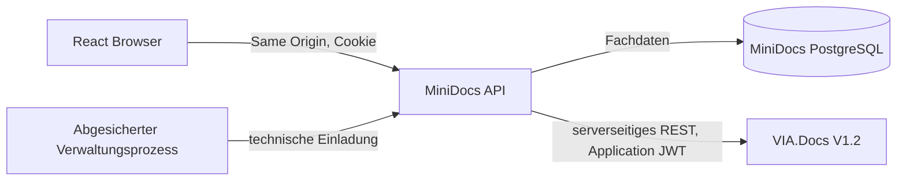
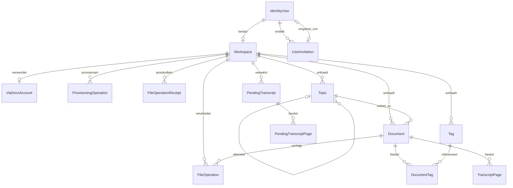
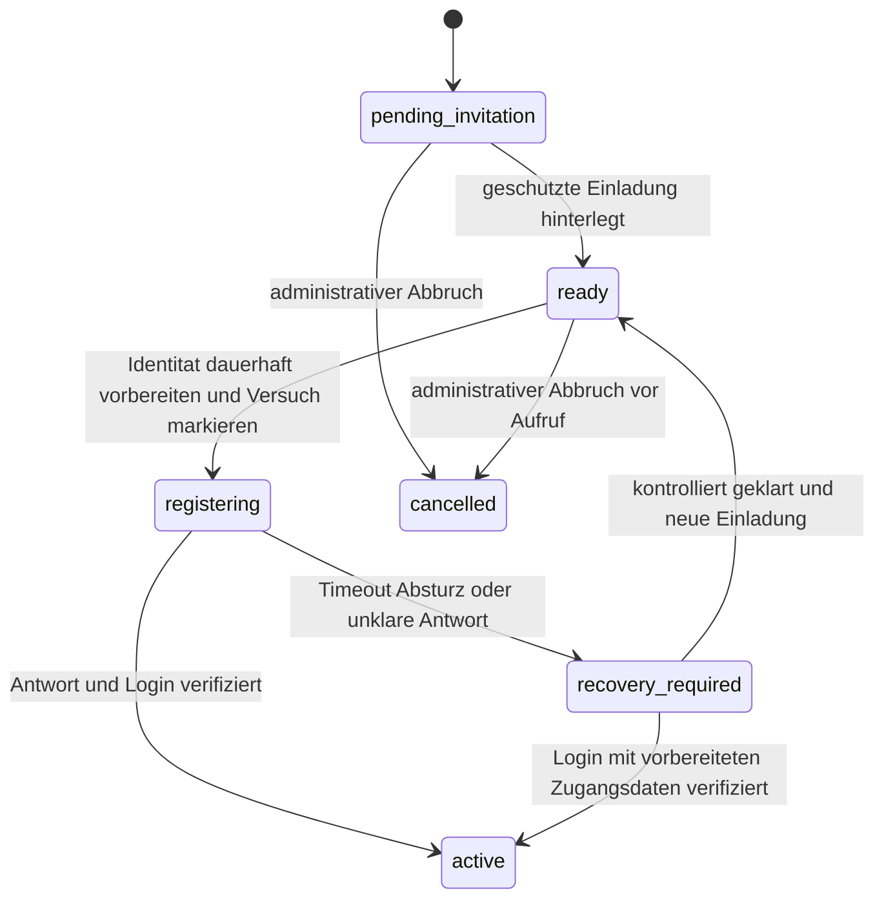
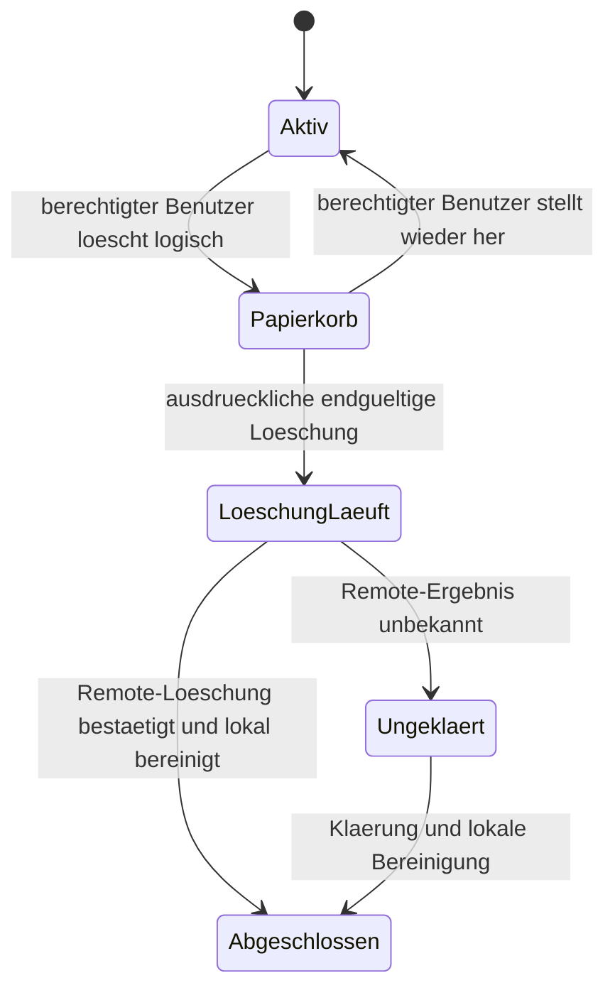

# VIA.MiniDocs – Gesamtarchitektur

Aktueller Frontend-Bestand und freigegebenes Backend-Zielbild. D1 und die D2-Persistenz einschließlich der Härtung aus D2-06 sind implementiert. D2 ist unabhängig technisch abgenommen (Note 1−); fachliche REST-Endpunkte und die VIA.Docs-Integration stehen aus. Verbindliche Entscheidungen stehen in [DECISIONS.md](DECISIONS.md), lokale Nachweise in [D2-06-VERIFICATION.md](D2-06-VERIFICATION.md), der externe Quellenstand in [VIA-DOCS-API.md](VIA-DOCS-API.md).

## Backend-Architektur V1.0

**Planungsstand:** [ADR-001 bis ADR-019](DECISIONS.md) sind fachlich freigegeben. ADR-013 beschreibt die Zielarchitektur für den Betrieb. D1 und D2-05 liegen als lokale Implementierung vor. D3–D8 benötigen gesonderte Aufträge. Der historische [Entwurf](ARCHITECTURE_DRAFT.md) dokumentiert frühere Planungsstände.



Ein regulärer Benutzer besitzt in V1.0 einen privaten Workspace mit eigener technischer VIA.Docs-Identität. Ausschließlich administrative Konten dürfen gemäß ADR-003 ohne Workspace existieren; fachlich nutzende Administratoren benötigen einen eigenen regulär provisionierten Workspace. Registrierung und Provisionierung sind getrennt. Die [Integration](VIA-DOCS-API.md) trennt Quellstand und Deployment; das unten beschriebene logische Modell ist kein Schema.

Das bestehende React-Frontend verwaltet Dokumente, Hierarchie, Tags und seitenweise Transkripte im Arbeitsspeicher. PDF-Import liest Seitenzahl und erzeugt lokale Blob-Quellen; der React-PDF-Viewer rendert fortlaufend und synchronisiert Seiten mit Transkriptkarten. Ein späterer autorisierter Streaming-Zugriff muss dieses Bedienkonzept berücksichtigen; der bestehende Blob-Pfad ist noch kein Backend-Streaming. Suche und Konfliktverhalten müssen vertraglich abgestimmt werden. [Frontend-Architektur](architecture/FRONTEND-ARCHITECTURE.md) und [PDF-Entscheidung](architecture/M6-C-PDF-ENTSCHEIDUNG.md) bewahren die UI-Abgrenzungen.

Aktuell dürfen nur nicht geschützte Themen ohne direkt zugeordnete Dokumente und ohne Unterthemen gelöscht werden; das Löschen verschiebt keine Dokumente. Der historische KU-Prototyp verhält sich anders. PDF-Leistung und Speicherverbrauch bei großen Dateien sind nicht systematisch gemessen; gemischte Seitenformate können die Scrollposition verändern. Die vollständige KU-Designabnahme bleibt offen, manuelle Touch-Prüfung ist ausdrücklich ausgenommen.

Für die Backend-Solution ist ein modularer Monolith mit Domain-, Application-, Infrastructure- und API-Projekten sowie Tests gemäß ADR-014 freigegeben. Die Projektabhängigkeiten und das vorgesehene Layout stehen dort; keine zusätzlichen Projekte ohne nachgewiesenen Bedarf. REST-Verträge und Engineering-Grundlagen sind in ADR-015 und ADR-016 freigegeben. Eine Implementierung ist gesondert zu beauftragen.

## Identität und Provisionierung

Gültige Entscheidungen: [ADR-001–009, ADR-012](DECISIONS.md). MiniDocs-Benutzereinladungen und technische VIA.Docs-Einladungen haben getrennte Aussteller, Zwecke und Lebenszyklen. Die erste verwendet nur gehashte, zufällige, befristete Einmaltokens. VIA.Docs-Registrierungsschlüssel verbleiben außerhalb des regulären Betriebs; Details der technischen Schnittstelle und ihr Status: [Integration](VIA-DOCS-API.md).

```mermaid
sequenceDiagram
  actor A as Administrator
  actor U as Benutzer
  participant M as MiniDocs
  participant V as VIA.Docs
  A->>M: Benutzereinladung erstellen
  U->>M: Einladung einlösen und registrieren
  M->>M: Konto und privaten Workspace anlegen; warten
  A->>V: Technische Einladung außerhalb des Betriebs erzeugen
  A->>M: Einladung geschützt für Workspace hinterlegen
  M->>M: Namen und Secret geschützt dauerhaft vorbereiten
  M->>V: Anwendung registrieren
  M->>M: ApplicationId verifizieren, zuordnen und aktivieren
```

Der Benutzer wartet gegebenenfalls auf den Administrator. Kein Vorrat technischer Einladungen, kein separater Provisionierungsdienst in V1.0. Kontosperrung und Workspace-Provisionierung sind getrennte Zuständigkeiten. Die Zustände `PendingInvitation`, `ReadyToProvision`, `Provisioning`, `RecoveryRequired`, `Active` sind **vorgeschlagen**, Übergänge und technische Durchsetzung noch zu spezifizieren.

Vor dem externen Aufruf Name und Secret dauerhaft geschützt festhalten und höchstens einen aktiven Vorgang pro Workspace zulassen. Bei Timeout oder unklarem Ergebnis zunächst mit denselben Zugangsdaten anmelden und Identität wiederauffinden. Fehlgeschlagener Login beweist keine Nichtregistrierung; kontrollierte Klärung statt blinder Wiederholung oder automatischer Löschung. Keine verteilte Transaktion und keine Exactly-once-Behauptung. Nach erfolgreicher Provisionierung das technische Einladungstoken entfernen. Fehlerzustände, abgelaufene Einladungen und manueller Wiederanlauf müssen später konkretisiert und getestet werden.

## Sicherheitsarchitektur

Die verbindlichen Entscheidungen zu Browserauthentifizierung, Secrets, Workspace-Isolation und Administrator-Bootstrap stehen in [ADR-009 bis ADR-012](DECISIONS.md). Same-Origin, Identity-Cookies, Antiforgery, Lockout und Rate Limiting schützen die MiniDocs-Sitzung; eine Kontosperre muss bestehende Sitzungen erfassen. Workspace und VIA.Docs-Application werden serverseitig bestimmt und autorisiert. Query-Filter sind eine zusätzliche Ebene; Datenbank-Constraints und zusammengesetzte Fremdschlüssel schützen Beziehungen. Administratoren erhalten keinen automatischen Zugriff auf Benutzerdateien. Nicht aktive Workspaces und gesperrte Benutzer dürfen keine Dokumentoperationen ausführen. Row-Level Security bleibt optional.

Data Protection benötigt getrennte, dauerhafte und gesicherte Schlüsselbestände je Umgebung und zweckgebundene, an Workspace oder Provisionierung gebundene Secrets; alte Schlüssel müssen lesbar bleiben. Konkrete Schutzmechanismen hängen vom unten beschriebenen Deployment ab. Fehlende Produktionskonfiguration darf nicht auf temporäre Schlüssel zurückfallen. Tokens, Secrets, Passwörter und JWTs gehören weder in Logs noch reguläre API-Antworten. Die vollständigen Anforderungen stehen in ADR-010.

## Verbindliche zukünftige Sicherheitstests

Die D2-PostgreSQL-Tests prüfen unter anderem Workspace-Fremdschlüssel (SEC-05/06), lokale Zustands- und Lease-Konflikte und die Runtime-Berechtigungen. HTTP-, Sitzungsschutz-, Integrations- und Betriebsnachweise bleiben gesonderte Abnahmen.

| ID | Nachweis |
| --- | --- |
| SEC-01 | Zugriff auf eigene Dokumente möglich. |
| SEC-02 | Fremde Dokumente nicht lesbar. |
| SEC-03 | Fremde Dokumente nicht veränderbar. |
| SEC-04 | Fremde Dokumente nicht löschbar. |
| SEC-05 | Workspace-übergreifende Themenzuordnung scheitert. |
| SEC-06 | Workspace-übergreifende Tagzuordnung scheitert. |
| SEC-07 | Fremde Transkripte nicht abrufbar. |
| SEC-08 | Administrator besitzt keinen automatischen Dokumentzugriff. |
| SEC-09 | Gesperrte Benutzer verlieren ihren Zugriff einschließlich bestehender Sitzungen. |
| SEC-10 | Parallele Provisionierung erzeugt keine Doppelregistrierung. |
| SEC-11 | Secrets erscheinen nicht in API-Antworten und Logs. |
| SEC-12 | Secrets bleiben nach Neustart verfügbar. |
| SEC-13 | Secrets bleiben nach Schlüsselrotation verfügbar. |
| SEC-14 | Backup und Restore erhalten die technische Identität. |
| SEC-15 | Parallele Anfragen verschiedener Workspaces vermischen keine JWTs. |

## B0.6 – PostgreSQL-Datenmodell und Persistenzarchitektur

**Datenmodell und Papierkorb gemäß ADR-017/018 fachlich freigegeben. PostgreSQL 18 ist die verbindliche Zielversion.** Für D2-05 gelten zusätzlich ADR-019 und der folgende Implementierungsstand. Die Betriebsfreigabe und der VIA.Docs-Deploymentstand sind offen. Die Diagramm-Kardinalitäten beschreiben den V1-Ablauf.

### Implementierte Schreibgrenze D2-05

Die Runtime hat auf den geschützten Fachobjekten keine direkte DML. Gezielte PostgreSQL-Funktionen übernehmen Invarianten, Zustandsbedingungen und atomare Aggregatänderungen. EF Core bleibt für Mapping, Migration, Abfragen und die spaltenbeschränkten Identity-Routineoperationen zuständig. Application autorisiert und orchestriert. Entwicklung fachlicher Endpunkte und authentifizierter Query-Filter folgt D4/D6.

Fachbefehle sperren den Workspace vor Kindzeilen. Die Workspace-Sperre beruht auf einem echten Zeilenupdate ohne fachlichen Versionswechsel, damit ältere PostgreSQL-Snapshots einen Schreibkonflikt erkennen. Die zugelassenen Befehle vergleichen erwartete Versionen und setzen neue Versionen und Zeitstempel serverseitig. Die bestehende Trigger- und FK-Absicherung bleibt für die gespeicherte Integrität erhalten. Privilegierte Datenkorrekturen müssen dieselbe Sperrreihenfolge einhalten. Einladungen sperren vor Workspace-Anlage zuerst die globale Einladungszeile.

Vor der Neuinstallation führt die DBA-Rolle im dedizierten Ziel `PrepareDatabaseRoles.sql` aus. `EnforceWriteBoundaries` installiert die Schreibgrenze und Validierung der lokalen Provisionierung. `FinalQualityHardening` ergänzt die Härtung und ersetzt bestehende Routinen als deren Besitzer `minidocs_command_owner`. Der Migrator darf dafür innerhalb der Migration zu dieser Rolle wechseln und räumt ihr Schema-`CREATE` nur innerhalb der Migrationstransaktion ein. Die Runtime kann die Rolle und interne Helper nicht aufrufen.

Führe nach Neuinstallation, Upgrade und Restore dasselbe lesende `GrantRuntimePrivileges.sql` aus und aktiviere die Anwendung nur bei Erfolg. Das Gate verwendet ein versioniertes Sollinventar für effektive Rechte, Rollen, Funktionssignaturen und -körper sowie relevante manuelle Schemaobjekte. Nach Dump-Restore mit vorbereiteten globalen Rollen stellt `RestoreDatabaseConnect.sql` nur die fehlende Datenbank-ACL wieder her. Aus dem Archiv geladene ACLs, Eigentümer und Defaults werden vor dem Gate nicht repariert. Altdaten ohne belegten Provisionierungsabschluss oder mit überlangen Leases erfordern vor der Migration eine kontrollierte Klärung. Bei Rückfall bleiben Schreibverkehr und Jobs gesperrt, bis Backup und offene externe Vorgänge abgeglichen sind.

Für neue Arbeit prüft PostgreSQL Workspace und Eigentümer in einer eigenen SQL-Anweisung nach erfolgreicher Workspace-Sperre. Auch die Eigentümerzeile wird bei der Prüfung gesperrt. Provisionierungsstarts verlangen einen wartenden Workspace. Dokumentoperationen verlangen einen aktiven Workspace. Berechtigung des angemeldeten Aufrufers und externe Nachweise bleiben in der Anwendung. Jobs dürfen bestehende Reservierungen klären, ohne damit einen neuen externen Aufruf zu erhalten. Ein bestätigter Provisionierungsabschluss darf einen suspendierten Workspace nicht reaktivieren.

Leases laufen höchstens **15 Minuten**. C# und PostgreSQL beziehen die Obergrenze aus derselben versionierten Ressource. Sie begrenzt die lokale Blockadedauer und liegt oberhalb des vorgesehenen 120-s-Idle-Timeouts. D4/D5 müssen einzelne Versuche mit ihren Timeouts und ihren Abbruchregeln innerhalb dieser Grenze betreiben. Ablauf erlaubt Klärung und erteilt keine erneute Schreibberechtigung.

`LocalWriteTransaction` gibt ein Ergebnis erst nach Commit frei und meldet Deadlocks oder Serialisierungsfehler als lokalen Konflikt. Ein verlorener Commit-Nachweis wird über die vorher festgelegte Operation oder Request-ID geklärt. Automatische Wiederholung einer externen Aktion ist dabei unzulässig. SQL-Argumentfehler verwenden `22023` mit `ck_command_argument` und erscheinen in C# als Argumentfehler. Fehlender oder veralteter Fachzustand bleibt ein fachlicher Konflikt. Unerwartete Datenbankfehler werden weitergereicht.



### Konventionen und Katalog

Vorschlag: Schema `minidocs`, Tabellen/Spalten `snake_case`; fachliche IDs als zufällige UUID, keine Namens-, Hash- oder Dateinamenidentität. `workspace_id` ist auf jeder workspacegebundenen Fachzeile `uuid NOT NULL`. `created_at`/`updated_at` sind `timestamptz NOT NULL` in UTC, serverseitig gesetzt; `version bigint NOT NULL DEFAULT 1` ist ein durch die Anwendung bei **jeder** Änderung der jeweiligen fachlichen Ressource atomar inkrementiertes EF-Concurrency-Token. Zeitstempel sind keine Concurrency-Tokens. `text` ohne spekulative Maximallängen, außer Sicherheits-/Protokollgrenzen; `?` bedeutet NULL erlaubt. Prüfungen und Indizes unten sind **vorgeschlagen**, nicht bereits durchgesetzt.

| Tabelle | Spalten zusätzlich zu `id uuid PK`, Zeitstempeln und `version`, sofern nicht anders genannt | Verantwortung und Regeln |
| --- | --- | --- |
| `identity_users` | Identity-Standardfelder für UUID-Key, UserName/NormalizedUserName, Email/NormalizedEmail, PasswordHash, SecurityStamp, ConcurrencyStamp, LockoutEnd, AccessFailedCount, TwoFactorEnabled und Bestätigungs-/Telefonfelder; zusätzlich `is_disabled boolean NOT NULL`, `account_kind text NOT NULL` (`admin_only` oder `regular`, CHECK auf diese Werte) | ASP.NET Core Identity, keine technischen VIA.Docs-Credentials. Identity-Normalisierung und Standardindizes beibehalten. `is_disabled` ist dauerhafte administrative Sperre, Identity-Lockout getrennt. |
| `identity_roles`, `identity_user_roles`, `identity_user_claims`, `identity_user_logins`, `identity_user_tokens`, `identity_role_claims` | UUID-User-/Role-FKs und die vom freigegebenen Identity-Provider benötigten Standardfelder und Schlüssel | Standard-Identity-Mapping und Migration exakt an gewählte .NET-/EF-Version anpassen; keine Logins/Claims erzeugen, die nicht benötigt werden. Identity-Tabellen sind global, keine fachlichen Workspace-Daten. |
| `user_invitations` | `token_hash bytea NOT NULL UNIQUE`, `created_by uuid NOT NULL`, `expires_at timestamptz NOT NULL`, `revoked_at timestamptz?`, `redeemed_at timestamptz?`, `redeemed_user_id uuid?` | Nur Hash des zufälligen Tokens; CHECK Länge 32 bei vorgeschlagenem SHA-256 und `expires_at > created_at`, Einlösungspaar beide NULL oder beide gesetzt; FKs auf Identity-User RESTRICT. Gültigkeit mit `clock_timestamp()` nach Erwerb der relevanten Sperre prüfen; weder Token noch Fehlerdaten loggen. |
| `workspaces` | `owner_user_id uuid NOT NULL UNIQUE`, `status text NOT NULL` | Eigenständige ID; UNIQUE je Benutzer und FK RESTRICT. Status `pending`, `active`, `suspended`; provisionierter Workspace wird erst nach überprüfter externer Identität aktiv. Benutzerstatus ist unabhängig. UNIQUE garantiert höchstens einen Workspace. Für `regular` ist genau einer, für `admin_only` keiner vorgeschlagen; ein fachlich nutzender Administrator ist zusätzlich `regular`. Atomare Anlage und vorgeschlagener deferred Constraint-Trigger prüfen Mindestanzahl und Account-Typ bei Commit sowie spätere Änderungen; Benutzerlöschung gesperrt. Die Präzisierung von ADR-003 ist freigegeben. |
| `via_docs_accounts` | `workspace_id uuid NOT NULL UNIQUE`, `application_name text NOT NULL UNIQUE`, `application_secret_protected bytea NOT NULL`, `application_id uuid? UNIQUE`, `verified_at timestamptz?` | Maximal eine vorbereitete technische Identität je Workspace; ApplicationId erst nach Verifikation setzen, `application_id` und `verified_at` gemeinsam NULL oder gesetzt. Name/Secret vor externem Aufruf dauerhaft speichern, Data-Protection-Zweck und Workspace binden. Ein `active`-Workspace verlangt verifiziertes Konto; transaktional unter Workspace-Sperre und als deferrable Constraint-Trigger absichern. Keine JWT- oder Adminregistrierungsschlüssel-Spalte. |
| `provisioning_operations` | `workspace_id`, `status text NOT NULL`, `invitation_protected bytea?`, `candidate_application_id uuid?`, `attempt_no integer NOT NULL`, `failure_category text?`, `updated_at`, `lease_owner uuid?`, `lease_until timestamptz?` | UUID-PK, FK Workspace RESTRICT, CHECK `attempt_no >= 0`, Status und Fehlerklasse aus untenstehender Liste; keine Tokens/Fehlertexte in Logs. `candidate_application_id` ist eine noch nicht verifizierte Antwort, nicht die dauerhaft aktivierte ApplicationId. Partieller UNIQUE-Index auf `workspace_id` für alle nicht abgeschlossenen Zustände, einschließlich unklarem Ergebnis; `lease_owner` und `lease_until` gemeinsam NULL oder gesetzt. Geschütztes Einladungstoken nach erfolgreicher Provisionierung entfernen. Lease-Ablauf ist kein Beweis für Nichtausführung. |
| `topics` | `workspace_id`, `parent_id uuid?`, `name text NOT NULL`, `system_key text?` | `UNIQUE(workspace_id,id)` als zusammengesetztes FK-Ziel; Eltern-FK `(workspace_id,parent_id)` → `topics(workspace_id,id)` RESTRICT, CHECK parent ≠ id. `system_key` nur NULL oder `UNASSIGNED`, dann parent NULL; partieller UNIQUE-Index auf workspace für Systemknoten. Name nach ECMAScript-Trim nicht leer. Seit D6-FUNC-01 je Workspace und Parent eindeutig, mit NULL als eigener Hauptebene. Die Datenbank vergleicht den getrimmten Namen in deutscher ICU-Kleinschreibung, die Anzeige behält die eingegebene Schreibweise. Auf der Hauptebene sind „Nicht zugeordnet“ und „Alle zugeordnet“ reserviert. Der geschützte Systemknoten ist von der Reservierungsprüfung ausgenommen. Mindestens ein Systemknoten durch initiale Transaktion und geschützten/deferrable Trigger sichern. Systemknoten weder löschen, umbenennen noch umhängen; keine Kinder darunter. |
| `documents` | `workspace_id`, `topic_id uuid NOT NULL`, `via_file_id uuid?`, `title text NOT NULL`, `file_name text?`, `kind text NOT NULL`, `document_date date?`, `page_count integer?`, `page_count_source text?`, `availability text NOT NULL`, `deleted_at timestamptz?`, `transcript_present boolean NOT NULL DEFAULT false`, `transcript_edited boolean NOT NULL DEFAULT false`, `transcript_revision bigint NOT NULL DEFAULT 0` | FK `(workspace_id,topic_id)` → Topic RESTRICT; `UNIQUE(workspace_id,id)` und partieller UNIQUE `(workspace_id,via_file_id)` bei vorhandener Datei-ID; CHECK `kind IN ('meeting','note')`, `page_count IS NULL OR page_count > 0`, `page_count_source` NULL genau bei unbekannter Zahl und sonst `pdf_import`, `viewer` oder `via_docs_verified`. Status `pending_upload`, `upload_failed`, `available`, `missing` oder `delete_pending`. CHECK Datei-ID NULL genau bei `pending_upload`/`upload_failed`; Statusübergänge über Service. Fachdatum ist Kalenderdatum. `deleted_at` kennzeichnet den freigegebenen Papierkorb; `transcript_revision >= 0` ist die atomare Aggregatrevision. `topic_id` bleibt auch im Papierkorb unverändert. Kein dauerhaftes PDF-Bytefeld. |
| `tags` | `workspace_id`, `name text NOT NULL`, `name_key text NOT NULL`, `description text NOT NULL`, `color text NOT NULL` | `UNIQUE(workspace_id,id)` und `UNIQUE(workspace_id,name_key)`; `name_key` muss serverseitig dieselbe Trim-/de-Lowercase-Regel wie das Frontend erfüllen und bei jedem Schreiben atomar berechnet werden. CHECK nichtleer, Farbformat `^#[0-9A-Fa-f]{6}$`; kein Akzent-Folding für Namensgleichheit. Normalisierung v1: ECMAScript-`trim()` (inklusive U+FEFF, ohne U+0085), danach deutsche Unicode-Kleinschreibung (`toLocaleLowerCase('de')` bzw. `lower` mit `pg_catalog."de-x-icu"`). Kein NFC/NFD- oder Akzent-Folding. HTTP trimmt, die D6-SQL-Kommandos verlangen bereits kanonisch getrimmte Namen; Themenname und Dokumenttitel verwenden dieselbe Trim-Regel. D6-Textlängen zählen Unicode-Codepoints (nicht UTF-16-Codeeinheiten oder Graphemcluster); Themenname/Dokumenttitel 1–255, Tagname 1–100, Tagbeschreibung 0–1000. Das separate 16-KiB-JSON-Limit bleibt unverändert. Unicode-/DB-Kollationsabweichungen mit gemeinsamen Gegenproben prüfen; Änderungen an der Normalisierung oder ICU-Version erfordern eine kontrollierte Prüfung bestehender Schlüssel und gegebenenfalls eine neue Migration. |
| `document_tags` | `workspace_id`, `document_id`, `tag_id`; PK `(workspace_id,document_id,tag_id)` | Zusammengesetzte FKs auf Document und Tag, jeweils RESTRICT; keine weitere ID/Versionsspalte. Zuweisungsänderung in Transaktion erhöht Document-Version. Gelöschte Tags werden gemäß bestehendem Verhalten explizit von Zuordnungen entfernt. |
| `transcript_pages` | `workspace_id`, `document_id`, `page_no integer`, `text text NOT NULL`, `edited boolean NOT NULL` | PK `(workspace_id,document_id,page_no)`, FK auf Document RESTRICT, CHECK `page_no >= 1`; `version` je Seite. Jede Einfügung, Änderung und Löschung erhöht die Dokument-Transkriptrevision in derselben Transaktion. Leere Textseite ist zulässig. `documents.transcript_present` unterscheidet fehlendes Transkript von vorhandenem leeren Transkript; `transcript_edited` bildet den dokumentweiten React-Bearbeitungsstatus ab. Beide werden mit jeder betroffenen Seitenmutation unter Dokument-Sperre und derselben Aggregatrevision gepflegt. |
| `pending_transcripts` und `pending_transcript_pages` | Kopf: `id`, `workspace_id`, `file_name text`, `imported_at timestamptz`, Status, version; Seiten: `workspace_id`, `pending_id`, `page_no`, `text` | **Geplanter V1-Import M7-B-TRANSKRIPT**, nicht vorhandener React-Fachzustand; Benutzerentscheidung bei Mehrdeutigkeit ist freigegeben; KU-Quelldateiformate siehe B0.7, Import ist noch nicht implementiert. FK Kopf `(workspace_id,id)`; Seiten-PK `(workspace_id,pending_id,page_no)` und CHECK Seite ≥ 1. Keine eindeutige Dateinamenannahme. |
| `file_operations` | `workspace_id`, `document_id uuid NOT NULL`, `kind text NOT NULL`, `state text NOT NULL`, `remote_file_id uuid?`, `failure_category text?`, `attempt_no integer NOT NULL`, `lease_owner uuid?`, `lease_until timestamptz?`, `request_id uuid?`, `verified_size bigint?`, `verified_sha256 bytea?`, `completed_at timestamptz?` | `request_id` für Upload NOT NULL, UNIQUE `(workspace_id,request_id)`; DELETE hat NULL. `verified_size` und `verified_sha256` sind gemeinsam NULL oder enthalten nach vollständigem serverseitigem Einlesen die tatsächliche Bytezahl und 32 SHA-256-Bytes; `completed_at` nur bei abgeschlossenem Vorgang. Die Request-ID wird nach einer späteren endgültigen Dokumentlöschung durch die unten beschriebene Sperrmarke erhalten. FK `(workspace_id,document_id)` → Document RESTRICT; `kind` upload/delete, Zustände siehe unten, ein partieller UNIQUE-Index `(workspace_id,document_id)` für alle offenen oder ungeklärten Vorgänge; keine PDF-Bytes und kein Nachweis externer Idempotenz. Nach finaler Löschung bleibt ein getrennter minimaler Abschlussnachweis ohne Dokumentinhalte oder Secrets erhalten. |

Alle UUID-FKs sind `uuid`, die Zeitstempel `timestamptz`, Versionen `bigint`; nicht ausdrücklich mit `?` gekennzeichnete Fachfelder sind NOT NULL. Identity-Standardtabellen folgen dem tatsächlichen Providervertrag statt einer erfundenen festen Spaltenliste; Spaltenlängen und Indizes daraus sind bei Schemafreigabe konkret abzugleichen. Provisionierungs-/Dateioperationen haben IDs, Zeitstempel und Version. `user_invitations.created_by` und `redeemed_user_id` besitzen FKs auf `identity_users`; Einladungen vor Einlösung sind noch keinem Workspace zugeordnet. Bei Aktivierung müssen Fach- und technische Identität konsistent und einmalig sein. Die DB allein garantiert nicht, dass jeder beliebige Datenbanknutzer den autorisierten Workspace verwendet: DB-Zugriff einschränken und sämtliche Schreibpfade serverseitig autorisieren.

Für den geplanten Pending-Import sind konkret `pending_transcripts(id uuid PK, workspace_id uuid NOT NULL, file_name text NOT NULL, source_name text?, meta_date text?, meta_topic text?, meta_title text?, meta_tags text?, imported_at timestamptz NOT NULL, status text NOT NULL, created_at/updated_at timestamptz NOT NULL, version bigint NOT NULL)` und `pending_transcript_pages(workspace_id uuid, pending_id uuid, page_no integer, text text NOT NULL, created_at/updated_at timestamptz NOT NULL, version bigint NOT NULL)` vorgeschlagen. Status zunächst `pending`, `matched`, `discarded`; Kopf besitzt `UNIQUE(workspace_id,id)` und Workspace-FK, Seiten den zusammengesetzten FK RESTRICT auf den Kopf. Pending-Import und Benutzerentscheidung bei Mehrdeutigkeit sind für V1.0 freigegeben; Bereinigung verbleibender technischer Kopfdatensätze ist noch zu konkretisieren. `is_disabled` ist der fachlich relevante Sperrstatus, ohne Lockout durch Fehlversuche zu ersetzen; Identity-Claims/-Tokens erhalten die vom Provider geforderten FKs und dürfen keine VIA.Docs-Secrets enthalten. Provider-Standardschlüssel mit zusammengesetzten Schlüsseln/Integer-Identitäten bleiben dort erhalten; die einheitliche UUID-Konvention gilt für Benutzer und eigene Aggregate.

`pending` bedeutet ungeklärt, `matched` erfolgreich übernommen, `discarded` ausdrücklich verworfen. Dateinamensabgleich liefert Kandidaten. Bei mehreren gleichnamigen Dateien entscheidet der berechtigte Benutzer. Die lokale Übernahme prüft Pending-Version und Transkriptrevision, aktualisiert das Dokument und entfernt die ursprünglichen Pending-Seiten atomar. Der beibehaltene Kopf enthält fachlich nur Dateiname, Importzeit und Status sowie technische IDs, Zeiten und Version. D7 ergänzt Import, Konfliktbedienung und Verwerfen, einschließlich atomarer fachlicher Anwendung der Quellmetadaten vor deren Bereinigung.

### Integrität, Löschung und Hierarchie

**Durchsetzungsvorschlag:** DB-FKs/UNIQUE/CHECK und partielle Unique-Indizes sichern höchstens einen Workspace pro Benutzer, höchstens einen Systemknoten je Workspace, höchstens ein Konto je Workspace, keine workspacefremden Beziehungen sowie höchstens einen offenen oder ungeklärten Dateivorgang je Dokument. Sie verhindern unbeabsichtigte Cascades. Das notwendige „mindestens eins“ für reguläre Konten/Systemknoten und die konsistente Kombination `active`/verifizierte ApplicationId/erfolgreiche Provisionierung erfordern atomare Service-Transaktionen und vorgeschlagene deferred Constraint-Trigger unter derselben Workspace-Sperre; die Trigger sind weder implementiert noch nachgewiesen. Gesperrte Konten sind requestweise zu prüfen. Ausschließlich administrative Konten dürfen gemäß freigegebener ADR-003-Präzisierung keinen Workspace besitzen; ein fachlich tätiger Administrator ist zusätzlich regulärer Benutzer. Cross-Workspace-Schreibversuche, parallele Aktivierung/Suspendierung, Systemknoten-Entfernung und direkte SQL-Umgehungsversuche benötigen echte PostgreSQL-Integrationstests.

`documents(workspace_id,topic_id)` → `topics(workspace_id,id)`, `document_tags(workspace_id,document_id)` → `documents(workspace_id,id)`, `(workspace_id,tag_id)` → `tags(workspace_id,id)` und `transcript_pages(workspace_id,document_id)` → Document weisen jede fremde Workspace-Zuordnung bereits an der FK-Grenze ab. FK-Ziele besitzen die genannten zusammengesetzten UNIQUE-Schlüssel; FK-Spalten erhalten eigene Indizes, soweit nicht durch PK/Index abgedeckt. Query-Filter sind zusätzliche Ebene, keine Sicherheitsgrenze. Write-Services leiten Workspace aus der authentifizierten Sitzung ab, prüfen aktiven Workspace/Benutzer und verwenden diesen in jedem Lese- und Schreibprädikat; auch `IgnoreQueryFilters`, Bulk-SQL, Jobs und Viewer-Streams benötigen explizite Autorisierung. Administratorrolle gewährt keinen Dokumentzugriff. RLS bleibt optional.

Empfehlung **Adjacency List** mit rekursivem CTE für Nachfahren: direktes Abbild des React-Baums und einfacher Umzug. Materialized Path verteuert Umzüge und braucht Pfadpflege; Closure Table erzeugt zusätzliche transaktional zu pflegende Zeilen. Beide sind erst bei gemessener Notwendigkeit vorzuziehen. FK und Selbstreferenz-CHECK verhindern keine längeren Zyklen. Alle Vorgänge, die Themenzuordnung oder -belegung verändern, einschließlich Themen-Neuanlage, Verschiebung, Löschung, Dokumentreservierung, Upload-Aktivierung, Dokumentverschiebung und Wiederherstellung, sperren in einer kurzen PostgreSQL-Transaktion zuerst dieselbe Workspace-Zeile `FOR UPDATE`, dann beteiligte Themen und Dokumente jeweils in stabiler UUID-Reihenfolge, danach Vorgänge und Transkriptseiten. Unter der Sperre werden Existenz, Systemknoten, Nachfahren, Belegung, Autorisierung, Version und aktiver Dateivorgang erneut geprüft. Konflikt oder Deadlock führt zu Rollback und kontrollierter Konfliktantwort; nur intern sichere, begrenzte Transaktionswiederholungen sind erlaubt. Kein Netzwerkaufruf erfolgt in dieser Transaktion. Upload-POST/DELETE liegen zwischen separaten Reservierungs- und Abschluss-Transaktionen; vor Abschluss werden Zielthema und Version erneut geprüft. Alle Schreibpfade einschließlich Jobs müssen diese Reihenfolge einhalten; DB-Rollen/ausgewiesene Schreibgrenze und ggf. Trigger müssen Umgehung verhindern. Nur Themen ohne direkte Dokumente und ohne Unterthemen löschen; belegte und Systemknoten bleiben geschützt. Papierkorbdokumente zählen als Belegung.

Überall RESTRICT/NO ACTION statt unbeabsichtigtem CASCADE; alle Fachtabellen mit `workspace_id` erhalten einen direkten FK auf `workspaces(id)` RESTRICT, Verknüpfungstabellen verwenden ihre zusammengesetzten PKs. Ein vorgeschlagenes `file_operation_receipts` speichert nach finaler Löschung nur `id uuid PK, workspace_id uuid NOT NULL, operation_id uuid NOT NULL UNIQUE, kind text NOT NULL, outcome text NOT NULL, completed_at timestamptz NOT NULL`; Workspace-FK RESTRICT, CHECK kind=delete und outcome=remote_deleted. Keine Dokument-ID, externe Datei-ID, Namen, Inhalte oder Secrets. Erstellung und lokale Bereinigung erfolgen in derselben Transaktion; Abgeschlossene Löschreceipts werden 30 Tage aufbewahrt; Workspace-Löschung bleibt offen. `deleted_from_topic_id` entfällt: die bestehende `topic_id` bleibt erhalten und das Thema gilt als belegt. Fallback auf `UNASSIGNED` nur nach gesonderter Entscheidung für Alt-/Inkonsistenzfälle. Benutzer-/Workspace-Löschung ist ohne separaten administrativen Ablauf verboten.

### Identity, Provisionierung und Transaktionsgrenzen

Identity mit UUID-Key, ein gemeinsamer scoped DbContext für Identity und Fachmodell und ein gemeinsamer PostgreSQL-Transaktions-/Connection-Kontext sind empfohlen. Benutzereinladung: in **einer** DB-Transaktion die zum Tokenhash gehörige Zeile `FOR UPDATE` sperren und nach Erwerb mit aktueller DB-Zeit prüfen (`redeemed_at IS NULL`, `revoked_at IS NULL`, `expires_at > now`); Identity-Benutzer über unterstützten Identity-Manager im selben Kontext anlegen, Workspace und Systemknoten anlegen und anschließend `redeemed_at` und `redeemed_user_id` gemeinsam setzen. Damit sind CHECK und sofortiger User-FK erfüllt; bei Identity-Validierung/Unique-Fehler alles zurückrollen. Provider-/ExecutionStrategy- und konkurrierende Einlösungsfälle gegen echtes PostgreSQL nachweisen. Einladungswiderruf und Einlösung konkurrieren über dieselbe Zeile. Administrator-Bootstrap bleibt lokaler geschützter Vorgang ohne Passwort im Argument; Autorisierung privater Dateien wird nicht vererbt. Kontosperre ist bei **jedem** Request bzw. mit nachweislich unverzüglicher Sitzungsinvalidierung durch serverseitige Validierung wirksam; reines periodisches SecurityStamp-Intervall reicht nicht für sofortigen Entzug.

Die Persistenz kennt `pending_invitation`, `ready`, `registering`, `recovery_required`, `active` und `cancelled`. D2-05 erzwingt den lokalen Start-, Verifikations- und Abschlussvertrag. Kontrollierte administrative Wiederfreigabe nach einem unklaren externen Aufruf folgt D4. Fehlerkategorien: `invitation_expired`, `authentication`, `transport_unknown`, `conflict`, `configuration`, `external_unavailable`, `verification_failed`, `manual_review`. Geheime Rohantworten werden nicht persistiert. Änderungen erfolgen in kurzen DB-Transaktionen mit Workspace-Zeilensperre und Version/Lease.



**Grenzen jedes REST-Aufrufs:** Vor Registrierung committen Transaktion A (`ready` → `registering`, Name und geschütztes Secret dauerhaft, Lease/Fencing-Version). Prozessabbruch unmittelbar vor **oder** nach Versand ist ununterscheidbar: beim Neustart abgelaufenes `registering` → `recovery_required`, kein automatischer zweiter Registrierungsaufruf. Nach erfolgreicher Antwort ApplicationId als vorläufiges Ergebnis in Transaktion B sichern; vor/nach anschließendem Login/Verifikation jederzeit erneuten Login mit denselben Zugangsdaten zulassen. Nach verifiziertem Login Transaktion C prüft Owner/Version und ApplicationId, setzt Konto verifiziert, Workspace/Operation aktiv und entfernt Einladungstoken. Abbruch vor C wiederholt nur Login. Fehlgeschlagener Login beweist keine Nichtregistrierung: `recovery_required` bleibt bis administrative Klärung, auch bei abgelaufenem Token, Namenskonflikt und transienten Fehlern. Übergang zurück zu `ready` erst nach dokumentierter Klärung; nie blind neu registrieren oder automatisch eine möglicherweise erfolgreiche externe Anwendung löschen. Eine alte Lease darf mittels Versions-/Fencing-Prüfung keine spätere Antwort übernehmen. Kein administrativer VIA.Docs-Registrierungsschlüssel wird gespeichert.

### Transkripte, Konflikte und Dateivorgänge

Seiten sind pro Dokument eindeutig und einsbasiert. Bei bekannter Seitenzahl prüft der Service `page_no <= page_count`; wenn sie unbekannt ist, erlaubt die derzeitige Demo nur Seite 1. DB-übergreifende Seitenzahlprüfung benötigt serialisierte Transaktion/Trigger und darf nicht als einfaches CHECK behauptet werden. Reduktion der Seitenzahl darf vorhandene Seiten nicht still löschen. **Jede** Seiteneinfügung, -änderung und -löschung sperrt nach gegebenenfalls erforderlicher Workspace-Sperre zuerst das Dokument, prüft die angegebene Aggregatrevision sowie ggf. Seitenversion und erhöht `transcript_revision` atomar in derselben Transaktion. Dokumentweites Replace-All sperrt dieselbe Dokumentzeile, vergleicht die beim Lesen gelieferte Aggregatrevision und verarbeitet erst danach die aktuellen Seiten in stabiler Seitenreihenfolge. Dadurch kann keine neu eingefügte oder gelöschte Seite als unbemerktes Phantom übergangen werden; fehlgeschlagener Vergleich rollt alles zurück. Der B0.7-Vorschlag verwendet starke ETags und `If-Match` für die Aggregatrevision; veraltete Revision `412`, fehlende Bedingung `428`. Transkripttext aus Demo-SVG ist keine echte Benutzerabschrift und wird nicht automatisch persistiert.

**Dateivorgangsvorschlag:** Dokument und Vorgang `prepared` in lokaler Transaktion anlegen; vor externem POST in eigener Transaktion `in_flight` mit Lease/Fencing markieren. Die PDF-Originaldatei verbleibt nur in VIA.Docs; nach Neustart ist ein noch nicht hochgeladenes Browser-Blob nicht verfügbar, daher erneuten Upload durch den Benutzer verlangen. Erhält der Server eine valide VIA.Docs-Datei-ID, persistiert er sie möglichst vor weiterer Verarbeitung in kurzer Transaktion (`remote_known`), dann verknüpft eine weitere atomare Transaktion Document und Vorgang (`completed`). Abbruch vor/nach jedem dieser Schritte ist über persistierte Zustände erkennbar. Nach verlorenem POST-Ergebnis ist `unknown` dauerhaft blockierend; keine automatische Wiederholung. Via File-Listen/Metadaten und Benutzer-/Adminprüfung lässt sich ein Kandidat untersuchen, aber ein identischer Name, Hash oder Zeitstempel beweist keine Identität, weil Duplikate erlaubt sind. Ohne nachgewiesene Korrelation ist eine manuelle Entscheidung/Abgleich nötig; kein Idempotency-Key oder Exactly-once-Versprechen. Ungeklärte externe Duplikate nicht automatisch löschen.

Der vorgeschlagene `file_operations.state`-Wertebereich ist `prepared`, `in_flight`, `remote_known`, `unknown`, `delete_in_flight`, `delete_unknown`, `completed`, `failed`; `kind` und erlaubte Zustände sind per CHECK gekoppelt. `attempt_no >= 0`, Lease-Felder beide NULL oder beide gesetzt. `prepared → in_flight → remote_known → completed`, bei ungeklärtem POST `in_flight → unknown`; `prepared → failed` nur bei nachweislich nicht begonnenem externem Aufruf. DELETE: `prepared → delete_in_flight → completed` oder `delete_in_flight → delete_unknown`; nach Klärung darf `delete_unknown` zu `completed` oder kontrolliert zurück zu `prepared` wechseln. `unknown → remote_known` nur nach überprüfter eindeutiger Zuordnung, andernfalls bleibt der Vorgang blockiert. Ein nachweislich vor Versand fehlgeschlagener `failed`-Upload wird nicht unter derselben Request-ID erneut extern gesendet; bei gesichertem Nichtbeginn kann der Benutzer einen neuen Vorgang mit neuer Request-ID auslösen. Änderungen werden mit Workspace-/Document-Sperre, Versionsvergleich und gültiger Lease committed; ein partieller UNIQUE-Index umfasst alle nichtterminalen Zustände einschließlich `unknown` und `delete_unknown`. Lease-Fencing schützt nur lokale Zustandsänderungen. Auch nach Beenden eines Workers kann ein bereits übermittelter Request remote noch verarbeitet werden; allein Lease-Ablauf oder Worker-Ende erlauben kein erneutes externes Schreiben.

Der bestätigte POST liefert erst eine vorläufige Remote-ID im Vorgang (`remote_known`); erst die lokale Zuordnung in derselben Transaktion wie `completed` setzt `documents.via_file_id` und `available`. Vor Versand sicher gescheiterter Upload kann `failed/upload_failed` werden; nach möglichem Versand bleibt `unknown/pending_upload` blockiert. Eine Remote-ID bleibt bis zur eindeutigen Klärung erhalten. Vor endgültigem DELETE werden Dokument und Vorgang atomar `delete_pending/delete_in_flight`; bestätigter Erfolg oder autorisiert nachgewiesenes Fehlen erlaubt lokale Bereinigung: Seiten, Zuordnungen und Vorgänge einschließlich completed löschen, Dokument löschen und minimalen Receipt atomar einfügen. Timeout ergibt `delete_unknown`, Dokument und technische Referenz bleiben erhalten. 401/403/Netzfehler beweisen kein Fehlen. Wiederholtes DELETE nur nach verifizierter Semantik und dokumentierter Klärung. Verzögerte Vorschau ist kein fehlendes Original.

Lease-Fencing schützt ausschließlich lokale Writes; die Beendigung eines Workers beweist nicht, dass VIA.Docs einen bereits übermittelten Request nicht mehr verarbeitet. Ein abgelaufener Lease berechtigt nie allein zum erneuten externen Schreiben. Der technische Administrator prüft nur Zustands- und Verbindungsmetadaten; keine automatische private Einsicht. Der berechtigte Workspace-Benutzer entscheidet über seine Dokumente; bei ungeklärtem externergebnis unterstützt ein gesondert autorisierter VIA.Docs-Betriebsverantwortlicher innerhalb seiner Berechtigung, ohne automatische Übernahme fremder oder mehrdeutiger Referenzen. Kann die sichere Klärung nicht erfolgen, bleibt der Vorgang blockiert. Kein Exactly-once-Versprechen.

**Papierkorb – ADR-018 freigegeben:** `deleted_at` markiert logische Löschung; normale Listen/Suche schließen den Eintrag aus. Original, unveränderte Themenzuordnung, Tags und Transkript bleiben erhalten. Papierkorbdokumente belegen ihr Thema; ein Löschversuch erhält eine verständliche Begründung. Ein berechtigter Benutzer kann wiederherstellen, solange kein endgültiger Löschvorgang begonnen oder unklar ist. Endgültige Löschung nur durch ausdrückliche Benutzeraktion; keine automatische Leerung oder Frist. Ungeklärte/fehlgeschlagene Löschungen bleiben sichtbar und nachvollziehbar. Der minimale technische Receipt speichert keine privaten Inhalte; er wird nach bestätigtem Abschluss 30 Tage aufbewahrt.



Wiederherstellung und endgültiges Löschen sperren dieselben Workspace- und Dokumentzeilen; nach Beginn oder ungeklärtem Remote-Ergebnis ist Wiederherstellung gesperrt. Fehler ohne extern gestarteten Request dürfen nach kontrolliertem Abbruch wieder in den Papierkorbzustand zurückkehren; nach möglichem Remote-Aufruf gilt die obige Klärung.

### Suche, Indizes und EF-Core-Migrationen

Referenz ist React `toLowerCase().normalize('NFD').replace(/[\\u0300-\\u036f]/g,'')`, nicht Umschrift `ü → ue` oder `ß → ss`. Phrasen sind zusammenhängende Teilstrings, alle Begriffe müssen dokumentweit über Titel/Dateiname und im Volltextmodus Transkriptseiten vorkommen; Tagfilter sind UND, Datum inklusiv und Themenfilter umfasst Nachfahren. Pro Begriff einmal +10 für Treffer in zusammengefügtem Titel/Dateiname, zusätzlich nicht überlappende Seitenvorkommen; Trefferseite ist die erste Seite des ersten Suchbegriffs mit Texttreffer, nicht automatisch die erste beliebige Seite. Leere Suche liefert alle gefilterten Dokumente, Relevanzsortierung absteigend und stabil. Ersetzen verwendet zusätzlich literale case-insensitive Semantik; nicht mit normalisierter Suche gleichsetzen.

Empfehlung: Workspace-/ID-, Eltern-, Datums- und Zuordnungs-B-Trees; z. B. `topics(workspace_id,parent_id)`, `documents(workspace_id,topic_id,document_date)`, `document_tags(workspace_id,tag_id,document_id)` sowie PKs. Eindeutige Constraints erzeugen bereits eigene Indizes. Normalisierte Titel-/Dateiname- und Seitentexte als **abgeleitete, transaktional aktualisierte** Suchwerte erwägen; gleiche versionierte Normalisierung für Speichern und Anfrage inkl. Unicode-/Locale-Gegenproben. Keine frei editierbare zweite Wahrheit. PostgreSQL `pg_trgm` GIN für normalisierte `%Teilstring%`-Kandidaten nach Messung evaluieren; sehr kurze Muster können ohne brauchbare Trigramme trotzdem Scans verursachen. B-Tree deckt Gleichheit/Filter ab, nicht allgemeine führende-Wildcard-Teilstrings. PostgreSQL-FTS mit Lexemen/Stemming und `unaccent`-Regeln ist kein belegter semantischer Ersatz für JavaScript-NFD; als Alternative nur bei expliziter Freigabe und Paritätstests. Regex-/LIKE-Sonderzeichen korrekt escapen. Als deterministischen Tie-Breaker für persistente Suchergebnisse `document_id ASC` nach dem gewählten Primärsortierschlüssel verwenden; diese Abweichung von der in der Demo eingabereihenfolgestabilen Gleichstandsregel ist fachlich freigegeben. Mit repräsentativen Daten `EXPLAIN (ANALYZE, BUFFERS)`, Latenzen, Indexgröße, Schreiblast und kurze Begriffe messen; keine Performancezusage. Siehe [PostgreSQL pg_trgm](https://www.postgresql.org/docs/18/pgtrgm.html) und [EF-Core-Concurrency](https://learn.microsoft.com/en-us/ef/core/saving/concurrency).

EF Core: ein IdentityDbContext mit fachlichen Konfigurationen je Entity; UUID-/zusammengesetzte Schlüssel, PostgreSQL-Partials, CHECK/FK, gezielte DeleteBehavior-RESTRICT und Filter pro Workspace explizit mappen. `bigint version` als application-managed `IsConcurrencyToken`, serverseitig bei jeder Änderung erhöht; PostgreSQL `xmin` wäre providergebunden und nicht als langfristige fachliche Versionsnummer geeignet. Für Bulk-Updates dieselben WHERE-Versionen und Zeilenzähler erzwingen. Transaktionsgrenzen oben implementieren, nicht durch ein generisches Repository-Framework verdecken. Versionierte EF-Migrationen mit reproduzierbarer Reihenfolge, separater kontrollierter Migrationsrolle und Prüfung etwaiger Extension-Rechte; PostgreSQL-Version, Migration/Rollback- oder Restore-Strategie und Deployment nach ADR-013 klären. Systemknoten bei Workspace-Anlage in derselben Transaktion initialisieren; Migration und Seed dürfen nicht bei parallelem Start duplizieren. Sicherheitskritische Integrations-/Migrationstests auf echtem PostgreSQL, kein InMemory-Ersatz.

### Kritisches Review und erforderliche Nachweise

Die ausgeführten PostgreSQL-Prüfungen zu Fremdschlüsseln, Kardinalität, alternativen Schreibpfaden, Nebenläufigkeit, Migration und Restore stehen in der [D2-06-Befundmatrix](D2-06-VERIFICATION.md) und dem [vorherigen D2-05-Nachweis](D2-05-VERIFICATION.md). Offen für die jeweiligen Integrationstickets sind insbesondere SEC-01–SEC-15 an ihren API-/Betriebsgrenzen, abgestürzte Worker an jedem REST-/Commit-Übergang, manuelle externe Klärung, Schlüsselrotation und systemübergreifender Restore, echte Upload-/DELETE-Timeouts, VIA.Docs-Identitätstrennung, Suchparität und Lastmessung.

Restrisiken: Unklare Remote-Dateien benötigen eindeutige Belege oder manuelle Klärung. Lease-Fencing schützt lokale Zustandsübergänge. Schlüsselverlust kann technische Identitäten unlesbar machen. Die Workspace-Autorisierung muss serverseitig wirksam sein und einschließlich Query-Filtern nachgewiesen werden. Abgleichverantwortung und Betriebsfreigabe nach ADR-013 bleiben offen.

## B0.7 – REST-Vertragsentwurf zur Architekturfreigabe

**Fachlich freigegeben, nicht implementiert.** Same-Origin-Cookie/Antiforgery gemäß ADR-009; alle mutierenden Browseranfragen benötigen Antiforgery. `M` bezeichnet authentifizierten aktiven Benutzer und serverseitig ermittelten aktiven eigenen Workspace; `A` ausschließlich Administratorfunktion ohne privaten Dateizugriff; `P` öffentlich, rate-limitiert. Keine Client-WorkspaceId als Autorisierung. UUIDs in Pfaden sind MiniDocs-IDs, niemals ungeprüfte VIA.Docs-IDs. Einheitliche Fehler als ProblemDetails (`type`, `title`, `status`, `detail`, `instance`, stabile `code`, `traceId` ohne Secrets); `400` Validierung, `401` keine gültige Session, `403` keine Berechtigung/Antiforgery, `404` nicht sichtbare Ressource, `409` Fachzustand/unklarer Vorgang, `412` veraltetes ETag, `428` fehlendes If-Match, `429` Rate-Limit, `503` vorübergehend extern nicht verfügbar. Nichtverfügbarkeit und Sperre dürfen keine fremden IDs verraten. `ETag`/`If-Match` sind starke opaque Tokens; Alle Updates atomar prüfen. `202` liefert einen abfragbaren Status und dessen URL; keine implizite externe Idempotenz. Retry ist nur bei dokumentiert sicherem Status gestattet. Listen verwenden begrenztes `limit`, undurchsichtigen `cursor`, `items`/`nextCursor` und stabile Sortierung inklusive UUID-Tie-Breaker; es wird kein bestandsweiter Snapshot garantiert.

| Methode / Route | Request → Response; Autorisierung | Erfolg / Konflikt / Wiederanlauf |
| --- | --- | --- |
| POST `/api/v1/session/login` | Zugangsdaten → Session-Cookie, Sessionstatus; P | 200, 401, 423/429 bei Sperre/Limit; nie Secrets zurückgeben. Kein automatischer Login-Retry. |
| DELETE `/api/v1/session` | Antiforgery → serverseitige Sitzung und Cookie ungültig; Session | 204 nach bestätigtem Widerruf oder bestätigtem No-op bei parallelem Entzug nach Requestprüfung; 401 bei neuem Request mit bereits ungültiger, abgelaufener oder fehlender Session; 403 bei ungültiger Antiforgery; 503 bei unklarem DB-Ergebnis. Der fachliche Effekt ist idempotent. |
| GET `/api/v1/session` | – → Benutzer, Rollen, Workspace-Status ohne Secrets; Session | 200/401; gesperrte Session unmittelbar entziehen. |
| GET `/api/v1/antiforgery` | – → Request-Token; anonym oder Session | 200 no-store; Cookie und Token gemäß Middleware. |
| POST `/api/v1/registration` | Einmal-Token, Zugangsdaten → Konto-/Workspace-Status; P | 201, 400/409/410/429; atomare Einlösung, verlorene Antwort über Login klären, Token nicht blind erneut verwenden. |
| GET/POST `/api/v1/admin/invitations` | Cursor bzw. Ablaufparameter → Liste bzw. einmaliges Token; A | 200/201, 400; Token nur einmal, no-store, nicht loggen; erneute Erstellung erzeugt neue Einladung. |
| GET `/api/v1/admin/invitations/{id}` | – → `Invitation`; A | 200/404; nie Token. |
| DELETE `/api/v1/admin/invitations/{id}` | – → widerrufen; A | 204/404/409, atomar gegen Einlösung. |
| GET `/api/v1/admin/users` | Cursor → `Page<AdminUser>`; A | 200; keine privaten Fachdaten. |
| PATCH `/api/v1/admin/users/{id}` | `AdminUserPatch` + `If-Match` → `AdminUser` und ETag; A | 200/400/404/409/412/428; Sperre trifft bestehende Sitzungen. |
| GET `/api/v1/admin/provisioning` | Cursor → Status ohne Secrets; A | 200; keine Dokumentdaten. |
| POST `/api/v1/admin/workspaces/{id}/technical-invitation` | technisches Token → Status; A | 202/409, no-store; geschützt speichern, keine Admin-Registrierungsschlüssel. Wiederholung nur bei sicherem Zustand. |
| POST `/api/v1/admin/workspaces/{id}/recovery` | Klärungsentscheidung ohne private Inhalte → Vorgangsstatus; A | 202/409; Rechteprüfung und dokumentierte Klärung, kein blinder Remote-Write. |
| GET `/api/v1/workspace` | – → eigener Status; Session | 200, bei Pending keine Dokumentoperation; 404 für ein administratives Konto ohne Workspace; keinerlei fremde IDs. |
| GET/POST `/api/v1/topics` | – bzw. `{name,parentId}` → Baum bzw. Thema mit ETag; M | 200/201, 400/409. Themenanlage prüft Systemknoten und Namensregeln. |
| GET `/api/v1/topics/{id}` | – → `Topic` und ETag; M | 200/404. |
| PATCH/DELETE `/api/v1/topics/{id}` | `{name,parentId}` bzw. –; `If-Match` → Thema bzw. –; M | 200/204, 409/412/428. PATCH prüft die endgültige Name-Parent-Kombination atomar. DELETE prüft die Belegung unter der Workspace-Sperre. |
| GET `/api/v1/documents` | Cursor/Sortierung/Filter → `Page<DocumentItem>`; M | 200; Papierkorb ausgeschlossen; keine PDF-Bytes. |
| GET/PATCH `/api/v1/documents/{id}` | – bzw. `DocumentPatch` + `If-Match` → Metadaten/ETag; M | 200, 409/412/428; Workspace-Sperre bei Themenwechsel. |
| POST `/api/v1/documents/batch-move` | `BatchMove` → `BatchMoveResult`; M | 200/400/404/409/412/428; alle Dokumentversionen atomar prüfen; Undo ist ein neuer Batch mit den gelieferten Zielversionen. |
| POST `/api/v1/documents/batch-tags` | `BatchTags` → `BatchDocuments`; M | 200/400/404/409/412/428; atomare Zuordnung und Versionsprüfung. |
| PUT `/api/v1/documents/{id}/page-count` | `PageCountUpdate` + Dokument-`If-Match` → `DocumentItem`; M | 200/400/409/412/428; vorhandene Transkriptseiten dürfen nicht abgeschnitten werden. |
| POST `/api/v1/documents/uploads` | Multipart `file`, Metadaten und `X-Request-ID` (UUID) → Dokument oder Operation; M | 201 bei abgeschlossenem Upload; 202 bei laufendem Vorgang; 400/409/413/415/503; Status anhand Request-ID abfragen. |
| GET `/api/v1/upload-requests/{requestId}` | – → Status der eigenen Upload-Anfrage; M | 200/404; niemals erneuter Remote-Upload. |
| GET `/api/v1/operations/{id}` | – → eigener fachlicher Status und erlaubte Aktion, keine Secrets; M | 200/404; `unknown` blockiert automatische externe Writes. |
| GET/HEAD `/api/v1/documents/{id}/content` | Range-/Cache-Header → autorisierter Stream/Metadaten; M | 200/206/304/416, 404/503; kein vollständiges Byte-Array, Header und Cancellation beachten. |
| GET `/api/v1/documents/{id}/preview` | – → Vorschau oder Status; M | 200/202/404/503; Preview-Verzögerung ist kein Beweis fehlender Originaldatei. |
| GET/POST `/api/v1/tags` | Cursor bzw. `{name,description,color}` → Liste/Tag; M | 200/201, 400/409; gleiche Namenssemantik wie Frontend prüfen. |
| GET `/api/v1/tags/{id}` | – → `Tag` und ETag; M | 200/404. |
| PATCH/DELETE `/api/v1/tags/{id}` | Werte + `If-Match` bzw. `If-Match` → Tag bzw. –; M | 200/204, 409/412/428; Zuordnungen transaktional bereinigen. |
| PUT/DELETE `/api/v1/documents/{id}/tags/{tagId}` | `If-Match` Dokument → geänderte Metadaten; M | 200, 404/412/428; zusammengesetzte Workspace-FKs. |
| GET `/api/v1/documents/{id}/transcript` | – → Seiten, Aggregatrevision/ETag; M | 200; atomarer Snapshot. |
| PUT/DELETE `/api/v1/documents/{id}/transcript/pages/{page}` | Text bzw. – plus Aggregat-`If-Match` → Aggregat/ETag; M | 200/204, 409/412/428; jede Mutation erhöht Revision. |
| POST `/api/v1/documents/{id}/transcript/replace-all` | `{query,replacement}` + Aggregat-`If-Match` → Ergebnis/ETag; M | 200/412/428; Dokument locken, kein Seitenphantom oder partieller Commit. |
| GET/POST `/api/v1/pending-transcripts` | Cursor bzw. `PendingImport` → `Page<PendingTranscript>` bzw. `PendingTranscript` plus ETag; M | 200/201/400/413; Mehrdeutigkeit erfordert Benutzerentscheidung. |
| GET `/api/v1/pending-transcripts/{id}` | – → `PendingTranscript` und ETag; M | 200/404. |
| POST `/api/v1/pending-transcripts/{id}/assign` | `{documentId,conflictAction}` + Pending- und Transkriptversion → Ergebnis; M; **vorläufig** | 200/409/412/428; beide Revisionen unter Sperre prüfen, atomar übernehmen; keine doppelte Zuordnung. |
| DELETE `/api/v1/pending-transcripts/{id}` | `If-Match` → verworfen; M; **vorläufig** | 204/412/428; Pending-Seiten explizit entfernen. |
| GET `/api/v1/search` | Suchtext, Modus, Zeitraum, Tags, Thema, Cursor → Treffer/Seite/Score; M | 200/400; React-Semantik, Papierkorb ausgeschlossen; UUID-Tie-Breaker freigegeben. |
| POST `/api/v1/documents/{id}/trash` | `If-Match` → Papierkorbstatus; M; **ADR-018 freigegeben** | 200/409/412/428; Original und Beziehungen erhalten. |
| GET `/api/v1/trash` | Cursor → eigene Papierkorbdokumente; M; **vorläufig** | 200; keine fremden Daten. |
| POST `/api/v1/trash/{id}/restore` | `If-Match` → Dokument; M; **vorläufig** | 200/409/412/428; während laufender oder ungeklärter endgültiger Löschung gesperrt. |
| DELETE `/api/v1/trash/{id}` | `If-Match`, ausdrückliche Benutzeraktion → Operation-ID; M; **vorläufig** | 202/409/412/428; Remote-DELETE und Abschlussnachweis wie B0.6, kein blindes Retry. |

### Kompakte Operationsprüfung

Die Routentabelle oben ist die einzige Operationsliste und zugleich die Prüfliste: **43 Zeilen mit 53 Einzelmethoden**. Die gemeinsamen Regeln direkt darüber und der DTO-/Statuskatalog darunter gelten zusätzlich für jede jeweilige Tabellenzeile. Für GET/HEAD entfallen Request-Body und Antiforgery, für zustandsändernde Methoden gilt `X-CSRF-TOKEN`; `If-Match` gilt für die explizit gekennzeichneten Ressourcen, Batch-ETags je Eintrag. `P`, `Session`, `A` und `M` bestimmen die im Tabellenkopf beschriebenen Rechte. 401/403/404 und 429 gelten ergänzend zur tabellarischen Auflistung nach Authentifizierung, Autorisierung und Rate-Limit; mutierende Operationen erhalten bei ungültigem Antiforgery 403. Fehlende oder veraltete vorgeschriebene Versionen ergeben 428 beziehungsweise 412.

- **Session und Einladung:** login, session GET/DELETE, antiforgery, registration, invitations GET/POST/GET-id/DELETE.
- **Administration und Workspace:** users GET/PATCH, provisioning GET, technical-invitation POST, recovery POST, workspace GET.
- **Themen:** topics GET/POST sowie topic-id GET/PATCH/DELETE.
- **Dokumente und Dateien:** documents GET, document-id GET/PATCH, batch-move und batch-tags POST, page-count PUT, uploads POST, upload-requests GET, operations GET, content GET/HEAD und preview GET.
- **Tags und Transkripte:** tags GET/POST, tag-id GET/PATCH/DELETE, document-tags PUT/DELETE, transcript GET, transcript-page PUT/DELETE, replace-all POST.
- **Import, Suche und Papierkorb:** pending-transcripts GET/POST, pending-id GET/DELETE, assign POST, search GET, trash POST/GET, restore POST und endgültiges DELETE.

Die Sichtprüfung ordnet jede dieser Methoden der Routenzeile, den DTOs und den gemeinsamen Regeln zu. UI-Zustände und lokales Undo sind keine getrennten REST-Ressourcen. Datenmodell-/React-Parität und Wiederanlauf sind als nachzuweisende Kriterien in D1–D8 verankert; diese Spezifikation behauptet keine erfolgreich durchgeführten Backendtests.

OpenAPI beschreibt DTOs, Header, mögliche Status und Sicherheitsgrenzen. Die folgenden DTOs und Grenzen definieren den API-Vertrag. Unterstützte Quelldateiformate folgen der KU-Referenz. Die [D2-05-Verifikation](D2-05-VERIFICATION.md) belegt die isolierten lokalen Datenbankabläufe. HTTP-Integration, aktuelle Sitzungssperre, externe Fehlerfälle und die entsprechenden SEC-01–SEC-15-Gates werden in den zuständigen Tickets nachgewiesen.

### DTOs, Grenzen und Fehlercodes

Alle nachfolgenden Felder sind erforderlich, sofern nicht `?` (= JSON `null` zulässig) oder `optional` (= bei PATCH weglassbar) angegeben. UUIDs sind kanonische Strings, `date` ist `YYYY-MM-DD`, `instant` ein UTC-RFC-3339-String; Versionswerte erscheinen ausschließlich als undurchsichtige starke HTTP-ETags. Alle Grenzen sind fachlich freigegeben und für D1 vor Abschluss zu prüfen, nicht als vorhandenes Verhalten belegt. JSON ist UTF-8; unbekannte Felder werden mit 400 abgewiesen. Standard-Listenlimit 50, höchstens 100; Cursor höchstens 2048 Zeichen. Titel/Themennamen/Dateinamen 1–255 Zeichen, Tagname 1–100, Tagbeschreibung 0–1000, Suchanfrage 0–512, Transkriptseite höchstens 1 MiB UTF-8, Transkriptimport höchstens 10 MiB und 10.000 Seiten. PDF zunächst höchstens 25 MiB pro Dokument als zentral konfigurierbare freigegebene Grenze, passend zum geprüften VIA.Docs-Quellstand. Eine Erhöhung erfordert einen bestätigten kompatiblen VIA.Docs-Vertrag und geeignete Tests; das tatsächliche Deployment ist nicht verifiziert. Siehe [Integrationsvertrag und Matrix](VIA-DOCS-API.md#quellabgleich-b0-final-c). `pageCount` ist `int32?` mit Werten 1–100000; Seitenzahl und Datum dürfen unbekannt sein. Passwörter und Identitätsnormalisierung folgen der konkret konfigurierten Identity-Policy, niemals ein Klartext-Passwort zurückgeben.

Gemeinsame Typen: `Page<T>={items:T[],nextCursor:string?}`; `Problem={type:string,title:string,status:int,detail:string?,instance:string?,code:string,traceId:string}`; `FileOperation={id:uuid,kind:upload|delete,state:prepared|in_flight|remote_known|unknown|delete_in_flight|delete_unknown|completed|failed,updatedAt:instant}`; Provisionierung verwendet `Provisioning` und ihre eigenen Zustände aus B0.6. Für sensible Daten `Cache-Control: no-store`. `400 validation_failed|cursor_invalid`, `401 authentication_required`, `403 forbidden|antiforgery_invalid`, `404 resource_not_found|operation_not_found`, `409 state_conflict|topic_name_conflict|topic_name_reserved|request_content_conflict|request_retired|operation_uncertain|topic_not_empty`, `410 invitation_expired`, `412 version_mismatch`, `413 payload_too_large`, `415 unsupported_media_type`, `423 account_locked`, `428 precondition_required`, `429 rate_limited`, `503 dependency_unavailable`; Fehlercodes enthalten keine privaten oder geheimen Werte. Für 401/403 keine automatische Cookie-Login-Umleitung auf API-Routen.

| DTO | Felder / Validierung |
| --- | --- |
| `AntiForgery` | `requestToken:string` (nicht leer); Cookie zusätzlich über Set-Cookie. |
| `Login` | `userName:string` (1–256), `password:string` (1–1024); `Session={userId:uuid,displayName:string,roles:string[],workspaceId:uuid?,workspaceStatus:pending\|active\|suspended\|null}`. |
| `Registration` | `token:string`, `userName:string`, `password:string`; `RegistrationResult={userId:uuid,workspaceStatus:pending}`; Token nie loggen. |
| `InvitationCreate` | `expiresAt:instant` (zukünftig, maximal 30 Tage); `Invitation={id:uuid,expiresAt:instant,redeemedAt:instant?,revokedAt:instant?}`; einmalige Create-Antwort ergänzt `token:string`, kein Token in Listen. |
| `AdminUser` | `{id:uuid,userName:string,isDisabled:boolean,accountKind:regular\|admin_only,roles:string[],etag:string}`; `AdminUserPatch={isDisabled:boolean}`. Letzten aktiven Administrator nicht sperren: 409 `state_conflict`. |
| `Provisioning` | `workspaceId:uuid,state:pending_invitation\|ready\|registering\|recovery_required\|active\|cancelled,updatedAt:instant`; Übergabe `{token:string}`; Recovery `{action:verify\|retry_if_safe}`. Keine privaten Inhalte. |
| `Workspace` | `id:uuid,status:pending\|active\|suspended`; ausschließlich eigener Workspace, technisches Application-Secret und Token fehlen. |
| `Topic` | `id:uuid,name:string,parentId:uuid?,isSystem:boolean`; Create `{name:string,parentId:uuid?}`, Patch `{name?:string,parentId?:uuid\|null}`. Server schützt Systemknoten, Zyklen und belegte Themen. |
| `Document` | `id:uuid,title:string,fileName:string?,kind:meeting\|note,documentDate:date?,topicId:uuid,tagIds:uuid[],pageCount:int?,availability:pending_upload\|upload_failed\|available\|missing\|delete_pending,deletedAt:instant?`; `DocumentItem={document:Document,etag:string}`; `DocumentPatch` erlaubt ausschließlich optionale `title:string`, `kind:meeting\|note`, `documentDate:date\|null`, `topicId:uuid`. `pageCountSource` bleibt intern. |
| `BatchMove` | `{items:{id:uuid,etag:string,targetTopicId:uuid}[]}`; 1–100 eindeutige IDs. `BatchMoveResult={items:{document:Document,etag:string,previousTopicId:uuid}[]}`. Bei gewöhnlicher Verschiebung erhalten alle Einträge dasselbe Ziel. Für Undo neue Versionen und vorherige Ziele je Dokument nutzen; ein inzwischen gelöschtes vorheriges Thema wird vom Client nach erneutem Baumabruf explizit durch den Systemknoten ersetzt. |
| `BatchTags` | `{items:{id:uuid,etag:string}[],tagId:uuid,on:boolean}`; 1–100 eindeutige IDs; `BatchDocuments={items:DocumentItem[]}`. |
| `PageCountUpdate` | `{pageCount:int,source:pdf_import\|viewer}`; 1–100000; Server validiert Änderung, Autorisierung und Version; externe Quelle nur intern `via_docs_verified`. |
| `Upload` | Multipart genau ein `file` PDF und `metadata` als JSON `{title:string,kind:meeting\|note,documentDate:date?,topicId:uuid}`, Header `X-Request-ID: uuid`; `UploadStatus={requestId:uuid,operation:FileOperation?,documentId:uuid?,state:prepared\|in_flight\|remote_known\|unknown\|completed\|failed\|retired}`. `metadata` kommt vor `file`, genau ein Feld je Name; Metadaten höchstens 16 KiB UTF-8, Boundary höchstens 128 ASCII-Zeichen und Multipart-Header pro Abschnitt höchstens 16 KiB, höchstens 16 Header. Dateiname aus dem Datei-Header übernehmen und Pfadbestandteile entfernen; PDF-Signatur und MIME-Typ prüfen. 201 liefert `DocumentItem` und `Location: /api/v1/documents/{id}`, 202 `UploadStatus` und `Location: /api/v1/upload-requests/{requestId}`. |
| `Tag` | `id:uuid,name:string,description:string,color:string`; Farbe `#RRGGBB`; Create/Patch verwenden die bearbeitbaren Felder, Patch mit optionalen Feldern. |
| `Transcript` | `{present:boolean,edited:boolean,pages:{page:int,text:string}[]}`; Seitennummer einsbasiert und bei bekannter PDF-Seitenzahl nicht darüber. PUT-Seite `{text:string}` setzt `present=true,edited=true`; DELETE entfernt die Seite, nicht das gesamte Transkript. Erstes Setzen einer leeren unveränderten Seite ist wie React ein No-op. Replace-all `{query:string,replacement:string}`; Suche nicht leer, jede Eingabe maximal 4096 Zeichen. |
| `PendingTranscript` | `id:uuid,fileName:string,sourceName:string?,meta:{date:string?,topic:string?,title:string?,tags:string?},status:pending\|matched\|discarded,importedAt:instant,candidateDocumentIds:uuid[],etag:string`; `PendingImport={fileName:string,sourceName:string?,meta:{date:string?,topic:string?,title:string?,tags:string?},pages:{page:int,text:string}[]}` als JSON, maximal 10000 eindeutige positive Seitennummern, 1 MiB Text je Seite und insgesamt 10 MiB UTF-8; Quelldatei-Konvertierung bleibt M7-B-TRANSKRIPT vorbehalten. Assign `{documentId:uuid,conflictAction:replace\|cancel}` plus Pending-ETag in `If-Match` und Transkript-ETag in `X-Transcript-If-Match`. Metadaten und Quelle werden unverändert zusammen mit dem wartenden Import gespeichert; ihre fachliche Anwendung beim Zuordnen wird in M7-B-TRANSKRIPT/D7 gemäß KU und den freigegebenen Zuordnungsregeln umgesetzt, keine Daten still verwerfen. Die KU-Referenz belegt Markdown `.md`/`.markdown` und strukturgleiches `.txt`: `# Dateiname.pdf`, `## Seite n`, optional Datum/Thema/Titel/Tags; mehrere PDFs pro Datei. Die React-Verarbeitung ist noch nicht implementiert und gehört zu M7-B-TRANSKRIPT/D7. DOCX ist im Prototyp nur ein Hinweis auf spätere Unterstützung; weitere Formate sind nicht belegt. |
| `SearchResult` | `{document:Document,etag:string,score:int,terms:string[],hit:{page:int,term:string}\|null}`; Suche `q`, `mode`, `topicId?`, `tagIds?`, `from?`, `to?`, `limit?`, `cursor?`. `mode=title\|full`, `sort=relevance\|date-desc\|date-asc\|title`; Ergebnis mit normalisierten `terms`, Trefferseite und Trefferbegriff. Filter und Sortierung einschließlich Score und UUID sind an den Cursor gebunden. |

Ergänzende Operationsbindung: Login nimmt `Login` und liefert `Session`; Logout hat keinen Request- oder Response-Body; Registrierung nimmt `Registration` und liefert `RegistrationResult`. `GET /admin/invitations` liefert `Page<Invitation>`, POST nimmt `InvitationCreate` und liefert `Invitation` mit einmaligem Token; Widerruf nimmt keinen Body. Technik-Einladung nimmt `{token:string}`, Recovery `{action:verify|retry_if_safe}`; beide liefern `Provisioning` und eine Status-URL unter `/api/v1/admin/provisioning` mit Filter `workspaceId`. Recovery verifiziert zunächst, `retry_if_safe` löst nur bei nachgewiesen nicht begonnenem oder nachgewiesen sicher wiederholbarem externem Vorgang eine Wiederholung aus. Topics POST nimmt `{name,parentId}`, GET einzeln liefert `Topic`, PATCH nimmt Topic-Patch und liefert `Topic`, DELETE keinen Body. Tags POST/PATCH nehmen Tag-Felder, GET einzeln liefert `Tag`. `POST /trash/{id}/restore` und `POST /documents/{id}/trash` nehmen keinen Body und liefern `DocumentItem`. `DELETE /trash/{id}` nimmt keinen Body und liefert `FileOperation` mit `Location: /api/v1/operations/{id}`. Pending-Zuweisung liefert `{document:DocumentItem,pending:PendingTranscript}` und ETags beider Aggregate; Verwerfen liefert 204. Ersetzen liefert `{transcript:Transcript,replacements:int}` mit Aggregat-ETag; Replace-all entspricht dem bestehenden Frontend: literaler, nicht-regexartiger, case-insensitiver Ersatz aller nicht überlappenden Treffer, während die Trefferanzeige normalisiert erfolgt.

Für Listen gilt: Topics liefert den vollständigen Baum als `{topic:Topic,etag:string}[]` in Eltern-vor-Kind-Reihenfolge. `GET /tags` liefert `Page<{tag:Tag,etag:string}>`, `GET /trash` `Page<DocumentItem>`, Einladungen `Page<Invitation>`, Provisionierung `Page<Provisioning>`. `GET /documents/{id}`, `PATCH` und Tagänderungen liefern `DocumentItem` mit zum `ETag`-Header identischem Token. `GET /transcript` liefert `Transcript` plus Aggregat-`ETag`; Seitenmutation 200 ebenso, 204 ohne Body mit neuem ETag. Tagzuordnung liefert 200 und `DocumentItem`, auch wenn das gewünschte Ergebnis bereits besteht; die Bedingung wird stets zuvor geprüft. DELETE Topic/Tag liefert 204 ohne Body. 201 nennt bei neu angelegter einzeln abrufbarer Ressource ihre `Location`; Registrierung liefert keine `Location`, da noch keine Sitzung besteht; jede 202-Antwort enthält `Location`, einen abfragbaren Status und `Retry-After` als Sekundenwert. Für eine noch nicht erzeugte Vorschau ist `Location` die Preview-Route selbst, Statusantwort `{state:"pending"}`. `GET /operations/{id}` gibt aktive Upload- und Löschvorgänge als `FileOperation` und nach Löschabschluss `{id,kind:"delete",state:"completed",completedAt:instant}` aus Receipt zurück; nach Ablauf 404.

Datumsortierung: `date-asc` mit NULL zuerst, `date-desc` mit NULL zuletzt, `title` nach vereinbarter deutscher Sortierung, jeweils UUID aufsteigend als letzter Schlüssel. Suche sortiert `relevance` nach Score absteigend dann UUID aufsteigend. Umfang und Nachfahren, UND-Verknüpfung der Tags, normalisierte Phrasen und Begriffe sowie Score folgen `search.ts`: pro Term Titel/Dateiname +10 einmal, zusätzlich nicht überlappende Seitentreffer, UND über Terme. Datumsbereich inklusiv; ungültige Daten, `from > to` oder unbekanntes Thema liefern wie React eine leere Trefferliste. Leere Suche liefert alle nach übrigen Kriterien passenden Dokumente. Titel-/Volltextmodus und erster Trefferbegriff werden wie im Frontend ermittelt. UI-Auswahl, Zoom, Ansichtsart und aktueller Tab sind lokale Sitzungszustände und benötigen keine API. Mehrfachaktionen sind atomar; mehrere PDF-Importe sind unabhängige Einzeluploads mit je Request-ID und separatem Ergebnis.

Alle GET/HEAD sind wiederholbar, mutierende Operationen nur bei dokumentiert sicherem Status. Create- und Login-Wiederholungen besitzen keine pauschale Idempotenzgarantie. Der Dateistream liefert keine JSON-DTOs: Content-Type, Content-Length sofern bekannt, ETag, Last-Modified, Accept-Ranges, Content-Range und Status werden kontrolliert weitergereicht. Status 206/304/416 sind keine ProblemDetails-Bodys, sofern HTTP keinen Body erlaubt. Vorschau liefert Bildstream oder 202 mit Status; 404 bedeutet nicht, dass das Original fehlt.

### OpenAPI und TypeScript

Vorschlag für D1: ASP.NET-Core-10-Endpoints und C#-DTOs sind einzige Vertragsquelle. `Microsoft.AspNetCore.OpenApi` plus `Microsoft.Extensions.ApiDescription.Server` erzeugen reproduzierbar beim isolierten Build OpenAPI; CI erzeugt danach mit gepinnter `openapi-typescript`-Version Strict-TS-Typen und prüft den generierten Diff. OpenAPI 3.1, Nullbarkeit, Enums, ProblemDetails, Multipart und Binary/Range müssen mit positiven und negativen Vertragsbeispielen gegen den Generator nachgewiesen werden; TS-Typen selbst implementieren weder Multipart-Streaming noch Laufzeitvalidierung. Das Projekt dokumentiert MIT-Lizenz und Unterstützung für OpenAPI 3.0/3.1 sowie TypeScript 5; der Generator ist nicht von der .NET-Version abhängig. Die konkrete Kombination mit .NET-10-Ausgabe und Strict-TS wird in D1 anhand eines Contract-Fixtures nachgewiesen. Versionen und Lockfiles pinnen; Kompatibilität vor tatsächlicher Installation prüfen. [Projekt und Lizenz](https://github.com/openapi-ts/openapi-typescript/blob/main/packages/openapi-typescript/README.md). Keine Paketinstallation in B0. Quelle: [Microsoft OpenAPI-Buildgenerierung](https://learn.microsoft.com/en-us/aspnet/core/fundamentals/minimal-apis/openapi?view=aspnetcore-10.0).

### Upload und Abbruch

**Freigegebener Vertrag:** Der Client erzeugt vor dem Request eine UUID als Request-ID. Der Server reserviert `(workspace_id,request_id)` unter Workspace-Sperre und Unique-Constraint vor externer I/O; `GET /api/v1/upload-requests/{requestId}` ist nur im ursprünglichen Workspace zugänglich. Gleichzeitige Requests konkurrieren atomar: nur der gewinnende Request darf den externen Upload beginnen. MiniDocs-interne Korrelation beweist keine Idempotenz von VIA.Docs.

Für einen eindeutigen Inhaltsvergleich liest und zählt MiniDocs die Bytes des eingehenden PDF-Streams vollständig und berechnet dabei SHA-256; nur ein vollständig serverseitig ermitteltes Paar aus Bytezahl und Digest wird gespeichert. Beim ursprünglichen Upload kann dies gleichzeitig mit dem Streaming zu VIA.Docs erfolgen, ohne dauerhafte zusätzliche PDF-Speicherung. Client-Digest, deklarierte Länge, Dateiname oder übereinstimmende Metadaten allein beweisen keine Inhaltsgleichheit. Ein Vergleich zweier vollständig serverseitig ermittelter Paare mit identischer Bytezahl und SHA-256 gilt innerhalb dieses Vertrags als Inhaltsgleichheit; unterschiedliches Paar ergibt 409 `request_content_conflict`. Ist für einen der Requests kein vollständig ermitteltes Paar verfügbar, wird Gleichheit nicht bestätigt. Der Vergleich eines wiederholten Bodys kann lokal gestreamt und verworfen werden; er darf keine externe Schreiboperation auslösen. Als schlanke Alternative zum erneuten Datei-Upload fragt der Client den Status ohne Inhaltsvergleich ab.

Ein `prepared`-Vorgang startet nach Request-Ende keinen erneuten externen Versand unter derselben ID: Nachweis und Streaming eines erneut gelieferten Bodies ließen sich ohne Puffern nicht vor dem externen Versand verbinden. Bei nachweislich nie begonnenem Aufruf kann der Nutzer die Datei mit einer neuen Request-ID erneut bereitstellen. Nach möglichem externem Beginn ist auch eine neue ID kein Freibrief für einen erneuten Upload derselben ungeklärten Aktion. `in_flight` wird nur abgefragt; `unknown` bleibt bis zur Klärung blockiert. `completed` liefert das gespeicherte Ergebnis bis zum Ende der Aufbewahrung; unvergleichbare Bytes erhalten den Status ohne Gleichheitsbestätigung, nicht die Behauptung eines erfolgreichen Inhaltsvergleichs. Abweichende gespeicherte Metadaten oder ein nachweislich unterschiedliches Vergleichspaar ergeben 409.

Für abgeschlossene Upload-Vorgänge werden Status und bestätigtes Ergebnis **vorgeschlagen 30 Tage ab Abschluss** erhalten. Danach wird unter Workspace-Sperre eine minimale `upload_request_tombstones(workspace_id,request_id)`-Sperrmarke atomar angelegt, bevor die abgeschlossene Vorgangszeile bereinigt wird; die Sperrmarke bleibt während der Workspace-Lebensdauer bestehen. Status `retired` enthält keine Dokument-ID, Digest, Dateigröße oder Dateidaten und ein wiederholter POST erhält 409 `request_retired`, niemals einen neuen externen Upload. Wird ein Dokument früher endgültig gelöscht, erfolgt diese Umwandlung bereits bei dessen Löschabschluss. Nicht abgeschlossene oder ungeklärte Vorgänge und Sperrmarken werden nicht automatisch entfernt. Die Frist betrifft keine Papierkorbdokumente und keine Löschreceipts.

Dateibytes werden nur während des eingehenden Requests übertragen, nie durch einen nach dessen Ende laufenden Worker aus dem Request-Stream gelesen und nicht dauerhaft bei MiniDocs gespeichert. Multipart-Streaming mit `MultipartReader` vermeidet das vollständige `IFormFile`-Model-Binding; Middleware und Proxy dürfen nicht unbemerkt puffern. Limits für Requestgröße, Anzahl gleichzeitiger Uploads, Timeouts und Proxy-Pufferung müssen vor Betriebsfreigabe konkret konfiguriert und getestet werden. Cancellation vor nachweislichem Versand erlaubt einen neuen Versuch mit erneut bereitgestellten Bytes; nach möglichem Versand bleibt das Ergebnis bei fehlender Bestätigung ungeklärt. Keine Datenbanktransaktion umfasst einen Netzwerkaufruf. 201 nur bei bestätigter Remote-Datei und atomar abgeschlossener lokaler Zuordnung, 202 bei fortbestehendem, per Request-ID abfragbarem Vorgang, andernfalls geeigneter ProblemDetails-Fehler; nach Verbindungsabbruch ist keine Zustellung einer Antwort garantiert. Quelle: [Microsoft Multipart-Streaming](https://learn.microsoft.com/en-us/aspnet/core/mvc/models/file-uploads?view=aspnetcore-10.0).

### Session, Antiforgery und Versionsbedingungen

Ein anonymer Same-Origin-GET `/api/v1/antiforgery` liefert vor Login oder Registrierung einen Request-Token; das zugehörige Antiforgery-Cookie wird vom Server gesetzt. Login, Registrierung, Logout und alle mutierenden Browseranfragen senden den Token im vorgesehenen Header; Cookie- und Tokenprüfung sind obligatorisch. Nach Login beziehungsweise Identitätswechsel muss ein neuer Token bezogen werden. Logout invalidiert die Sitzung und anschließend wird ein neuer anonymer Token benötigt. Abgelaufene oder gesperrte Sitzungen liefern 401, eine ungültige Antiforgery-Prüfung 403; gesperrte Konten müssen auch bei bereits ausgegebenem Cookie serverseitig abgewiesen werden. Cookies: Secure, HttpOnly für Authentifizierung, geeignete SameSite-Einstellung und begrenzter Geltungsbereich; keine Browser-JWTs. Vite nutzt lokal einen kontrollierten Same-Origin-Proxy. Request-Token im Header `X-CSRF-TOKEN`; Auth-Cookie `Secure; HttpOnly; SameSite=Lax; Path=/`, Antiforgery-Cookie ebenfalls Secure und HttpOnly, SameSite=Strict, Path=/. Lokale Entwicklung benötigt HTTPS oder ausdrücklich auf localhost begrenzte Entwicklungsparameter; Produktionsregeln bleiben unverändert.

Ressourcen-ETags gelten für die vollständige tatsächlich ausgelieferte Repräsentation: auch indirekte Änderungen wie eine Tag-Löschung müssen ein repräsentationsabhängiges ETag ändern oder die Repräsentation darf keine abhängigen Daten enthalten. Die dokumentweite Transkriptrevision ist ein gesondertes Aggregat-ETag; Seiten-ETags und Dokumentmetadatenversionen sind keine austauschbaren Bedingungen. `If-Match` wird atomar ausgewertet: fachlicher Konflikt 409, veraltete Bedingung 412, fehlende erforderliche Bedingung 428. Vorschlag: undurchsichtige, manipulationsgeschützte Cursor binden serverseitig ermittelten Workspace, sämtliche Filter und Sortieroptionen sowie alle Sortierschlüssel einschließlich Relevanz und UUID; ungültige, workspace- oder filterfremde Cursor werden mit 400 `cursor_invalid` abgewiesen. Dieselbe Bindung gilt für alle paginierten Fachlisten. Adminlisten sind an die administrative Identität, Filter und Sortierung gebunden. Änderungen zwischen Seiten können Ergebnisse verschieben, wiederholen oder auslassen; kein bestandsweiter Snapshot.

Die Einlösung einer Benutzereinladung prüft die tatsächliche PostgreSQL-Zeit **nach** Erwerb der relevanten Sperre, etwa mit `clock_timestamp()`, nicht den eingefrorenen Transaktionsbeginn. Quelle: [PostgreSQL-Zeitfunktionen](https://www.postgresql.org/docs/current/functions-datetime.html).

### Endgültige Löschung und Nachweis

Nach bestätigter fachlicher Löschung in VIA.Docs werden lokale Bereinigung und Receipt-Erstellung atomar committed. Beim Entfernen des Upload-Vorgangs verbleibt eine datensparsame `upload_request_tombstones(workspace_id, request_id)`-Sperrmarke mit zusammengesetztem Primärschlüssel und Workspace-FK; dieselbe Request-ID kann nicht für einen neuen Upload verwendet werden, solange der Workspace besteht. Die Markierung enthält keine Datei-ID, Metadaten, Inhalte oder Secrets und ist von den 30-Tage-Löschreceipts getrennt. Reservierung prüft Operation und Sperrmarke atomar unter Workspace-Sperre; der Status der Sperrmarke ist `retired` ohne Dokumentdaten. Der Receipt enthält Workspace-ID, ursprüngliche Operation-ID, technischen Abschlussstatus und Zeitpunkt, keine privaten Inhalte oder Secrets. Der berechtigte Workspace-Benutzer kann den Löschabschluss über die ursprüngliche Operation-ID 30 Tage lang abfragen; nach Ablauf und sicherer Bereinigung ist 404 `operation_not_found` vorgesehen. Ein begrenzter Wartungslauf entfernt ausschließlich abgeschlossene, abgelaufene Receipts und braucht keinen Zugriff auf Dokumentinhalte; ungeklärte Vorgänge bleiben erhalten. Fachlich bestätigte VIA.Docs-Löschung, abgeschlossene lokale Bereinigung und physische Löschung beim Storage-Provider sind getrennte Tatsachen. Eine 404 allein beweist keine physische Löschung; diese ist nicht zugesichert.

## Hosting, Deployment und Betrieb

**B0.8: ADR-013 als Zielarchitektur freigegeben; keine Betriebsfreigabe.** Keine Installation oder Betriebsabnahme. Same-Origin ist durch ADR-009 freigegeben; Prozessgrenzen folgen ADR-014–018.

### Grundlage und bevorzugte Variante

- Lokal ist ein Windows-Entwicklungsrechner mit .NET SDK 10.0.404 dokumentiert; dies belegt keinen Windows-Server oder eine Zielruntime. Der lesend geprüfte VIA.Docs-Quellarbeitsbaum (Branch `feature/v1.2-s3-storage`, HEAD `7ffed6ab7a1125c6f14c5f664f12ffefbeaf1da8`) dokumentiert .NET, PostgreSQL und FileSystem-/S3-Arbeiten. Der dortige uncommittete V1.2-Masterplan **berichtet** eine isolierte Linux-Testinstallation mit offener PDF-Preview-Abnahme; das README berichtet Debian-13-Funktionsnachweise und offene externe Produktionsabnahme. Das belegt kein erreichbares, geeignetes MiniDocs-Hosting, keine Produktionsfreigabe und keinen deployten Einladungsendpunkt. Keine Infrastruktur und kein produktiver API-Zugriff wurden in diesem Auftrag geprüft.
- **Empfehlung unter zu bestätigenden Annahmen:** ein unterstützter Linux-Host, ein einzelner ASP.NET-Core-10-Prozess unter `systemd`, Kestrel nur auf Loopback und Nginx als TLS-Reverse-Proxy; derselbe Prozess liefert den React-Produktionsbuild. Eigene MiniDocs-PostgreSQL-Datenbank auf einer zugelassenen Instanz, eigene Betriebsidentität. Keine zusätzlichen Broker, Containerplattform oder separater Frontenddienst. Voraussetzung: Betreiber stellt unterstützte Linux-/PostgreSQL-Version, Betrieb, isolierte Rechte, TLS, verschlüsselten dauerhaften Speicher und Backup nachweislich bereit. Ob Nginx oder ein vorhandener Proxy nutzbar ist, muss der Betreiber bestätigen. Die Variante ist eine freigegebene Zielarchitektur, keine Bestandsaussage. Microsoft dokumentiert [Linux/Nginx und Kestrel](https://learn.microsoft.com/en-us/aspnet/core/host-and-deploy/linux-nginx?view=aspnetcore-10.0).
- **Vergleich:** Windows mit IIS und dedizierter App-Pool-Identität, PostgreSQL, TLS und DPAPI/Zertifikat ist grundsätzlich möglich; auch dort sind Prozess-, Migrations-, Backup- und Restore-Verfahren sowie Serverrechte gesondert nachzuweisen. Linux mit systemd/Nginx hat dokumentierte .NET-Unterstützung und passt unter Vorbehalt zu den berichteten Linux-VIA.Docs-Tests; gemeinsamer Betreiber und vorhandene Proxy-/PostgreSQL-Kapazität sind nicht belegt. Beide Plattformen erfordern Patchpflege, Rechtekontrolle, kontrolliertes Deployment und geprüften Restore. Linux wird wegen der einfachen Ein-Prozess-Topologie und der dokumentierten Linux-Bezüge vorbehaltlich Betreiberprüfung bevorzugt.

### Origin, Proxy und Prozess

Der versionierte React-Build liegt im Release des modularen Monolithen; Nginx terminiert TLS und leitet einen freigegebenen Hostnamen an Kestrel/Loopback weiter. `/api/v1/` und Health-Routen werden vor SPA-Fallback behandelt: unbekannte API-Routen geben API-404/ProblemDetails, nie `index.html`; SPA-Fallback nur für HTML-Navigation. Statische Assets mit Hash dürfen lange und unveränderlich gecacht werden, `index.html`, private API-Antworten und Tokens nicht. Port und Firewall erlauben keinen externen Direktzugang zu Kestrel oder PostgreSQL. Nginx verwirft unbekannte Hostnamen, überschreibt eingehende Forwarded-Header und setzt eigene. ASP.NET Core akzeptiert nur explizit bekannte Proxy-IP-Adressen, erlaubte Hosts, notwendige `X-Forwarded-For`/`Proto` und eine begrenzte Hop-Zahl; kein globales Vertrauen in fremde Proxies. Middleware vor Authentifizierung/Redirects konfigurieren. Siehe [Microsoft Forwarded Headers](https://learn.microsoft.com/en-us/aspnet/core/host-and-deploy/proxy-load-balancer?view=aspnetcore-10.0).

Ein eigener nicht privilegierter OS-Benutzer je Umgebung betreibt den einzelnen Service; Release-Dateien sind für ihn nur lesbar, Schreibrechte nur für Key Ring und notwendige Laufzeitbereiche. systemd startet nach Fehler mit begrenztem Backoff neu; kein automatisches Wiederholen ungeklärter VIA.Docs-Schreibvorgänge. Laufzeit- und Administrationskonten sind getrennt. Zugriffsrechte für Zertifikat, DB-Konfiguration und Backups sind getrennt; keine Secrets in Unit-Dateien, Argumenten oder Git.

**Betriebsparameter als Startvorschlag, vor Demo-/Produktivbetrieb nach Messung freizugeben:** PDF-Nutzlast höchstens 25 MiB gemäß B0.7 als freigegebene Grenze; Proxy-Requestlimit zunächst 26 MiB für Multipart-Overhead, Kestrel-Gesamtlimit identisch, Remote-Gesamtgrenze einschließlich VIA.Docs-Overhead separat prüfen; Metadaten- und Headerlimits gemäß Vertrag. Upload-Route mit `proxy_request_buffering off`, HTTP/1.1 zum Upstream und ohne Request-Body-Logging; Middleware darf nicht über `IFormFile`/Form-Model-Binding vollständig puffern. Proxy-/App-Idle-Timeout zunächst 120 s, maximal zwei gleichzeitige Uploads pro Instanz und begrenzte Gesamt-/pro-Benutzer-Raten; Idle-Grenzen garantieren keine Gesamtdauer. File-/Range-Responses ohne vollständige `byte[]`-Pufferung weiterreichen; `Range`, `If-Range`, `Content-Range`, 200/206/304/416 und Cancellation an Proxy und VIA.Docs-Grenze nachweisen. Nginx-Response-Buffering für Datei- und Preview-Routen deaktivieren; keine privaten Inhalte über Proxy-Cache. VIA.Docs selbst verwendet `ReadFormAsync` und kann multipart puffern; ungepuffertes MiniDocs-Streaming ist kein Nachweis eines ungepufferten Gesamtsystems. Chunked Requests und tatsächliche Proxy-Konfiguration prüfen; [Nginx-Dokumentation](https://nginx.org/en/docs/http/ngx_http_proxy_module.html#proxy_request_buffering). CPU-/RAM-/Dateideskriptor- und DB-Verbindungsgrenzen anhand von Lasttests festlegen; kein unbegrenztes Warteschlangenwachstum.

`/health/live` prüft nur Prozesslebendigkeit; `/health/ready` prüft benötigtes Schema, Datenbank, Schlüsselkonfiguration und initialisierte Services ohne Secrets. VIA.Docs-Ausfall separat sichtbar machen; Schreibvorgänge scheitern kontrolliert, Readiness-Politik für rein lokale Lesefunktionen ist vor Betrieb festzulegen. Health liefert keine internen Details öffentlich; Proxy begrenzt den Zugriff auf autorisierte Betriebsprüfer. Strukturierte Logs enthalten Zeit, Level, Trace-ID, Operationstyp, Ergebnis und Dauer, aber keine PDF-/Transkriptinhalte, Tokens, Cookies, Passwörter, Einladungen, Secrets oder Connection-Strings. Vorschlag: 30 Tage begrenzt rotierte, zugriffsgeschützte Logs; Betreiber bestätigt Aufbewahrung und Speicherquote. Fehler- und Wiederanlaufalarme ohne private Inhalte.

### Umgebungen und Geheimnisse

Lokale Entwicklung nutzt eigene Testdaten und Konfiguration; automatisierte Tests isolierte kurzlebige Datenbanken und Testdoubles, niemals Produktionszugänge. Demo/Abnahme und spätere Produktion haben getrennte Datenbanken, Prozessidentitäten, Schlüsselbestände, TLS-/Konfiguration und VIA.Docs-Anwendungsidentitäten; `Claus_Demo` und `Klaus-Uwe-Demo` haben jeweils eigene Workspaces, technische ApplicationId/Secret und Dokumentbestände, auch innerhalb derselben Demo-Instanz. JWT-Caches ausschließlich serverseitig und strikt pro technischer ApplicationId/Workspace getrennt. Keine Weitergabe von Produktionsdaten oder Credentials in Entwicklungs- und Demo-Konfigurationen.

Data Protection verwendet je Umgebung ein dauerhaftes, vom Release getrenntes Dateisystemverzeichnis mit minimalen Service-ACLs, einen stabilen umgebungsspezifischen Application Name sowie ein separat bereitgestelltes X.509-Zertifikat mit privatem Schlüssel zum Verschlüsseln der Key-Ring-Dateien. Die private Schlüsseldatei/Passphrase werden über einen vom Betreiber freigegebenen geschützten Credential-Kanal bereitgestellt, nicht in Git, Unit-Argumenten, Logs oder gewöhnlichen Umgebungsdateien. `PersistKeysToFileSystem` allein verschlüsselt nicht automatisch: explizit `ProtectKeysWithCertificate` konfigurieren. Purposes sind stabil, versioniert und nach Secret-Typ getrennt; Workspace- und Vorgangs-ID bilden zusätzliche Purpose-Bestandteile. Keine Eigenkryptografie; getrennte Laufzeit-/Backuprechte. Alte Data-Protection-Schlüssel und alte Zertifikate samt privatem Schlüssel bleiben bis zur nachgewiesenen Umverschlüsselung oder Löschung aller davon abhängigen Daten und Backups erhalten; Zertifikatsrotation unterstützt alte Zertifikate zum Entschlüsseln. Schlüsselring samt Schlüsselverschlüsselungszertifikaten und benötigten Passphrasen werden verschlüsselt, getrennt und wiederherstellbar gesichert. Siehe [Microsoft-Konfiguration](https://learn.microsoft.com/en-us/aspnet/core/security/data-protection/configuration/overview?view=aspnetcore-10.0).

Erstinstallation initialisiert den Schlüsselbestand ausdrücklich als administrativen Einmalvorgang; spätere Starts prüfen persistente Schlüssel, Zertifikat und einen zuvor geschützten Prüfwert. Fehlender/leerer/beschädigter Bestand, falsche Anwendungsidentität, fehlender privater Schlüssel oder fehlgeschlagene Entschlüsselung führen zum kontrollierten Start-/Readiness-Fehler. Kein stillschweigender neuer temporärer Produktions-Key-Ring. Neustart, Rotation und Serverwechsel mit wiederhergestelltem Ring/Zertifikat müssen praktisch getestet werden. Bei endgültigem Schlüsselverlust keine automatische Neuerzeugung vorhandener technischer Identitäten: Betrieb stoppen, Wiederherstellung bzw. getrennt autorisierte Wiederbereitstellung klären.

Der erste Administrator entsteht nur durch einen lokal und einmalig ausgeführten berechtigten Betriebsprozess mit einmaligem Geheimnis über geschützte interaktive Eingabe oder privaten Credential-Kanal; keine CLI-Geheimnisargumente, kein öffentlicher Bootstrap-Endpunkt, keine Defaultpasswörter, Audit ohne Geheimnis. Technische VIA.Docs-Einladung wird im separat abgesicherten VIA.Docs-Verwaltungsprozess erzeugt und über die per TLS, Administrator-Session und Antiforgery geschützte MiniDocs-Verwaltungsfunktion einmalig übertragen, serverseitig zweck-/workspacegebunden verschlüsselt und nach erfolgreicher Provisionierung entfernt. Keine Tokens in URL, Logs oder regulären Benutzerantworten; administrative VIA.Docs-Registrierungsschlüssel bleiben außerhalb des MiniDocs-Regelbetriebs.

### PostgreSQL und Wiederherstellung

Eigene MiniDocs-Datenbank je Umgebung; keine VIA.Docs-Datenbankzugriffe. Laufzeitrolle ohne Superuser, CREATE DATABASE, Schema-/Objektbesitz oder Migrationsrechte, mit ausschließlich erforderlichen CONNECT/USAGE und DML-/Sequenzrechten auf MiniDocs-Objekten. Separate zeitlich kontrolliert verwendete Migrationsrolle besitzt nur erforderliche Schema-/DDL-Rechte; Extension-Installation gegebenenfalls durch DBA, kein Superuser-Secret in Anwendung. Lokale/CI-Tests verwenden eigene isolierte Datenbanken. EF-Core-Migrationen werden versioniert, vorab gegen Testkopie geprüft und kontrolliert als gesonderter Deployment-Schritt angewendet; Anwendung validiert beim Start Schema-Kompatibilität, führt aber keine Produktionsmigration aus. Migrationsversion, Artefaktversion und Mindest-/Maximalschema werden vor Aktivierung geprüft.

Poolgröße, Timeout, Connection-Lifetime und PostgreSQL-Verbindungslimit sind als gemeinsame Kapazität je Umgebung zu konfigurieren; Startvorschlag maximal 20 Verbindungen pro Instanz, an tatsächliche DB-Grenzen und andere Anwendungen anzupassen. Kurze Transaktionen mit festen Lock-/Statement-Timeouts, konsistenter Sperrreihenfolge und kontrolliertem Konflikt; DB-Transaktionen nie über externe HTTP-Aufrufe offenhalten. Überwachen: Poolauslastung, lange Transaktionen, Sperrkonflikte, Speicher und Fehler; keine unkontrollierten Retrys externer Writes.

**Backup-Vorschlag:** mindestens täglich ein konsistentes verschlüsseltes PostgreSQL-Backup (z. B. `pg_dump` im passenden Format) und nach Schlüssel-/Konfigurationsänderungen sofortige Sicherung von Key Ring, Zertifikaten, Wiederherstellungsmaterial und nicht geheimen Versions-/Schema-Metadaten. Getrennte geschützte Sicherung der technischen Wiederanlauf-Credentials; Zugriff minimal und protokolliert. Betreiber muss Häufigkeit, Aufbewahrung, Speicherort, RPO/RTO und ggf. zusätzliche WAL-/PITR-Strategie freigeben; ein täglicher Dump bietet keine beliebige Zeitpunktwiederherstellung. Zuständigkeit für konsistente VIA.Docs-Metadaten und jeweilige Binary-Storage-Backups liegt beim VIA.Docs-Betreiber und muss bestätigt werden. Regelmäßiger isolierter Restore-Test einschließlich Datenbankrollen, Schlüsselbestand, Zertifikat und freigegebener Testidentität ist verpflichtend. [PostgreSQL Backup/Restore](https://www.postgresql.org/docs/current/backup.html).

**Restore:** externe Schreibpfade und Jobs sperren, Ziel und betroffene Zeitpunkte dokumentieren; isoliert DB, Schema-/Versionsstand, Key Ring und erforderliche Zertifikate/Secrets wiederherstellen. Schreibfähigkeiten bleiben bis zur Klärung von VIA.Docs-Konto, Dateireferenzen und allen offenen Provisionierungs-/Dateivorgängen gesperrt. Bei DB-Restore auf älteren Zeitpunkt können Remote-Dateien oder Remote-Löschungen inzwischen stattgefunden haben: keine Annahme, dass ein vor dem Backup noch nicht sichtbarer Vorgang nie extern ausgeführt wurde. Kandidaten nur durch berechtigten Benutzer/Betrieb manuell prüfen; keine automatische Übernahme mehrdeutiger Dateien, kein blindes POST/DELETE und keine automatische Bereinigung unklarer Vorgänge. Erst nach Freigabe, Schlüssel- und Integritätsprüfung sowie Smoke-Tests kontrolliert aktivieren. Datenbank-Restore allein ist kein Gesamtrestore und keine Zusicherung physischer VIA.Docs-Löschung.

### Release, Migration und Rollback

1. In isolierter Buildumgebung aus eindeutigem Git-Commit mit gepinnten Tool-/Paketständen reproduzierbare Frontend- und .NET-Release-Artefakte erstellen; Version, Commit, Schema-Bereich und SHA-256-Manifest ohne Secrets festhalten. Kein Deployment von Arbeitsbaumdaten.
2. Vor Deployment Integrationsgates, Konfiguration, TLS, Rechte, Kapazität, Test- und Zielsystemidentität prüfen. Rückfallpfad und externen Schreibstopp festlegen. Sicherung von DB und Schlüsselmaterial vor riskanter Migration prüfen; Backup-Erfolg und Restorefähigkeit nicht verwechseln.
3. Artefakt in neues unveränderliches Release-Verzeichnis übertragen und Hash/Manifest prüfen. Geschützte Konfiguration außerhalb der Artefakte bereitstellen. Falls Migration nötig ist, Schreibverkehr und relevante Jobs kontrolliert stoppen, laufende/ungeklärte Vorgänge erfassen, Migration einmalig mit Migrationsrolle ausführen und Ergebnis/Schema überprüfen. Keine Migration beim normalen Service-Start.
4. Kandidatenprozess geschützt starten, lokale Live-/Ready-, Auth-/Antiforgery- und nichtdestruktive Smoke-Tests mit freigegebenen Testdaten durchführen; API-404, SPA-Fallback, Proxy/TLS und Range gesondert prüfen. Externe Schreibtests nur mit ausdrücklicher Freigabe und isolierten Identitäten. Nach positiver Prüfung Proxy kontrolliert auf Kandidaten schalten und Betriebswerte überwachen.
5. Bei Fehler Traffic zurücknehmen. Binär-Rollback nur, wenn altes Artefakt das vorhandene Schema nachweislich unterstützt; sonst Schreibbetrieb sperren und anhand geprüftem Backup und abgestimmtem Recovery-Plan wiederherstellen. Destruktive Downgrade-Migrationen oder DB-Only-Restore sind kein pauschaler Rückweg; nach zwischenzeitlichen VIA.Docs-Schreibvorgängen muss jede externe Konsistenzlücke kontrolliert geklärt werden.

### Gates und Betreiberentscheidungen

**Vor lokaler Implementierung:** gesonderter Implementierungsauftrag; fachliche Freigabe des betroffenen Vertrags und sicherheitskritischer Detailentscheidungen vor deren Umsetzung. Ein echter Produktionsserver, ADR-013-Betriebsabnahme und reale VIA.Docs-Zugänge sind keine Voraussetzung für D1 mit Testdoubles. **Vor realer Integration:** freigegebene isolierte VIA.Docs-Version/Migration und technische Einladung, getrennte Testidentitäten, bestätigter API-Vertrag, Testauftrag und nachgewiesene Rechte; uncommitteter Quelltext ist kein Deployment-Nachweis. **Vor Demo-/Deployment-/Produktivfreigabe:** ADR-013 und Betreiberverantwortung, tatsächliche Host-/OS-/PostgreSQL-/Proxy-/TLS-Verfügbarkeit, Prozess- und Backuprechte, Credential-/Zertifikatsbereitstellung, Daten-/Key-Ring-Restore, Ressourcenlimits, Monitoring und End-to-End-Nachweise einschließlich Range/Streaming sind zu bestätigen. D8 führt die Betriebsszenarien aus; D3–D5 prüfen den VIA.Docs-Vertrag; D2 Migration/Restore, D4 Schlüssel und Session. Kein Test ist durch diese Planung bereits bestanden.

**Betreiberentscheidungsliste:** Zielhost und Trennung der Umgebungen; PostgreSQL-Version, Kapazität und Rechte; Proxy/IPs, DNS, TLS-Ausstellung/-Erneuerung; Service-/Migrations-/Backupidentitäten und Credential-Kanal; Key-Ring-Standort, X.509-Zertifikat, Rotation und Wiederherstellungsverantwortung; Log-Aufbewahrung und Alarmierung; Upload-/Timeout-/Ressourcenwerte und verfügbare VIA.Docs-Limits; Backupfrequenz, RPO/RTO, Aufbewahrung und gemeinsame Restore-Zuständigkeiten; Vorgehen bei unbekannten Remote-Vorgängen; Wartungsfenster und Versions-/Schema-Rollback.
