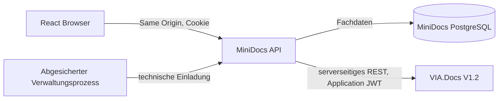
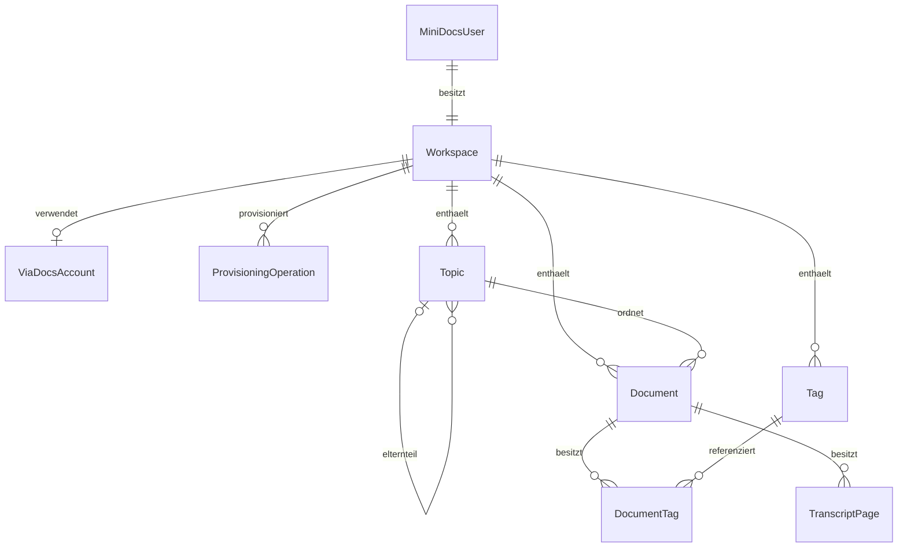

# VIA.MiniDocs – Gesamtarchitektur

Aktueller Frontend-Bestand und freigegebenes Backend-Zielbild. Backend und Persistenz sind nicht implementiert; Architekturplanung ist keine Implementierungsfreigabe. Verbindliche Entscheidungen und ihre Status stehen ausschließlich in [DECISIONS.md](DECISIONS.md), der externe Quellenstand in [VIA-DOCS-API.md](VIA-DOCS-API.md).

## Backend-Architektur V1.0

**Planungsstand:** [ADR-001 bis ADR-012](DECISIONS.md) sind fachlich freigegeben; ADR-013 bis ADR-016 sind offen beziehungsweise vorgeschlagen. Es gibt keine Implementierungsfreigabe und noch kein MiniDocs-Backend. Der historische [Entwurf](ARCHITECTURE_DRAFT.md) ist keine aktuelle Entscheidungsquelle.



Ein Benutzer besitzt in V1.0 einen privaten Workspace und dieser eine eigene technische VIA.Docs-Identität. Registrierung und Provisionierung sind getrennt. Die [Integration](VIA-DOCS-API.md) trennt Quellstand und Deployment; das unten beschriebene logische Modell ist kein Schema.

Das bestehende React-Frontend verwaltet Dokumente, Hierarchie, Tags und seitenweise Transkripte im Arbeitsspeicher. PDF-Import liest Seitenzahl und erzeugt lokale Blob-Quellen; der React-PDF-Viewer rendert fortlaufend und synchronisiert Seiten mit Transkriptkarten. Ein späterer autorisierter Streaming-Zugriff muss dieses Bedienkonzept berücksichtigen; der bestehende Blob-Pfad ist noch kein Backend-Streaming. Suche und Konfliktverhalten müssen vertraglich abgestimmt werden. [Frontend-Architektur](architecture/FRONTEND-ARCHITECTURE.md) und [PDF-Entscheidung](architecture/M6-C-PDF-ENTSCHEIDUNG.md) bewahren die UI-Abgrenzungen.

Aktuell dürfen nur nicht geschützte Themen ohne direkt zugeordnete Dokumente und ohne Unterthemen gelöscht werden; das Löschen verschiebt keine Dokumente. Der historische KU-Prototyp verhält sich anders. PDF-Leistung und Speicherverbrauch bei großen Dateien sind nicht systematisch gemessen; gemischte Seitenformate können die Scrollposition verändern. Die vollständige KU-Designabnahme bleibt offen, manuelle Touch-Prüfung ist ausdrücklich ausgenommen.

Für eine Backend-Solution ist ein modularer Monolith mit Domain-, Application-, Infrastructure- und API-Projekten sowie Tests **vorgeschlagen**; die Abhängigkeitsrichtung und der unfreigegebene Projektvorschlag stehen vollständig in ADR-014. ADR-015 und ADR-016 sind ebenfalls nicht freigegeben.

## Identität und Provisionierung

Gültige Entscheidungen: [ADR-001–009, ADR-012](DECISIONS.md). MiniDocs-Benutzereinladungen und technische VIA.Docs-Einladungen haben getrennte Aussteller, Zwecke und Lebenszyklen. Die erste verwendet nur gehashte, zufällige, befristete Einmaltokens. VIA.Docs-Registrierungsschlüssel verbleiben außerhalb des regulären Betriebs; Details der technischen Schnittstelle und ihr Status: [Integration](VIA-DOCS-API.md).

```mermaid
sequenceDiagram
  actor A as Administrator
  actor U as Benutzer
  participant M as MiniDocs
  participant V as VIA.Docs
  A->>M: Benutzereinladung erstellen
  U->>M: Einladung einlösen und registrieren
  M->>M: Konto und privaten Workspace anlegen; warten
  A->>V: Technische Einladung außerhalb des Betriebs erzeugen
  A->>M: Einladung geschützt für Workspace hinterlegen
  M->>M: Namen und Secret geschützt dauerhaft vorbereiten
  M->>V: Anwendung registrieren
  M->>M: ApplicationId verifizieren, zuordnen und aktivieren
```

Der Benutzer wartet gegebenenfalls auf den Administrator. Kein Vorrat technischer Einladungen, kein separater Provisionierungsdienst in V1.0. Kontosperrung und Workspace-Provisionierung sind getrennte Zuständigkeiten. Die Zustände `PendingInvitation`, `ReadyToProvision`, `Provisioning`, `RecoveryRequired`, `Active` sind **vorgeschlagen**, Übergänge und technische Durchsetzung noch zu spezifizieren.

Vor dem externen Aufruf Name und Secret dauerhaft geschützt festhalten und höchstens einen aktiven Vorgang pro Workspace zulassen. Bei Timeout oder unklarem Ergebnis zunächst mit denselben Zugangsdaten anmelden und Identität wiederauffinden. Fehlgeschlagener Login beweist keine Nichtregistrierung; kontrollierte Klärung statt blinder Wiederholung oder automatischer Löschung. Keine verteilte Transaktion und keine Exactly-once-Behauptung. Nach erfolgreicher Provisionierung das technische Einladungstoken entfernen. Fehlerzustände, abgelaufene Einladungen und manueller Wiederanlauf müssen später konkretisiert und getestet werden.

## Sicherheitsarchitektur

Die verbindlichen Entscheidungen zu Browserauthentifizierung, Secrets, Workspace-Isolation und Administrator-Bootstrap stehen in [ADR-009 bis ADR-012](DECISIONS.md). Same-Origin, Identity-Cookies, Antiforgery, Lockout und Rate Limiting schützen die MiniDocs-Sitzung; eine Kontosperre muss bestehende Sitzungen erfassen. Workspace und VIA.Docs-Application werden serverseitig bestimmt und autorisiert. Query-Filter sind eine zusätzliche Ebene; Datenbank-Constraints und zusammengesetzte Fremdschlüssel schützen Beziehungen. Administratoren erhalten keinen automatischen Zugriff auf Benutzerdateien. Nicht aktive Workspaces und gesperrte Benutzer dürfen keine Dokumentoperationen ausführen. Row-Level Security bleibt optional.

Data Protection benötigt getrennte, dauerhafte und gesicherte Schlüsselbestände je Umgebung und zweckgebundene, an Workspace oder Provisionierung gebundene Secrets; alte Schlüssel müssen lesbar bleiben. Konkrete Schutzmechanismen hängen vom unten beschriebenen Deployment ab. Fehlende Produktionskonfiguration darf nicht auf temporäre Schlüssel zurückfallen. Tokens, Secrets, Passwörter und JWTs gehören weder in Logs noch reguläre API-Antworten. Die vollständigen Anforderungen stehen in ADR-010.

## Verbindliche zukünftige Sicherheitstests

Anforderungen, **nicht implementiert oder bestanden**. Sicherheitskritische Persistenz- und Isolationstests müssen mit echtem PostgreSQL stattfinden.

| ID | Nachweis |
| --- | --- |
| SEC-01 | Zugriff auf eigene Dokumente möglich. |
| SEC-02 | Fremde Dokumente nicht lesbar. |
| SEC-03 | Fremde Dokumente nicht veränderbar. |
| SEC-04 | Fremde Dokumente nicht löschbar. |
| SEC-05 | Workspace-übergreifende Themenzuordnung scheitert. |
| SEC-06 | Workspace-übergreifende Tagzuordnung scheitert. |
| SEC-07 | Fremde Transkripte nicht abrufbar. |
| SEC-08 | Administrator besitzt keinen automatischen Dokumentzugriff. |
| SEC-09 | Gesperrte Benutzer verlieren ihren Zugriff einschließlich bestehender Sitzungen. |
| SEC-10 | Parallele Provisionierung erzeugt keine Doppelregistrierung. |
| SEC-11 | Secrets erscheinen nicht in API-Antworten und Logs. |
| SEC-12 | Secrets bleiben nach Neustart verfügbar. |
| SEC-13 | Secrets bleiben nach Schlüsselrotation verfügbar. |
| SEC-14 | Backup und Restore erhalten die technische Identität. |
| SEC-15 | Parallele Anfragen verschiedener Workspaces vermischen keine JWTs. |

## Logischer Datenmodellentwurf

**Entwurf, kein freigegebenes physisches Schema.** Tabellen, Datentypen, Indizes, Constraints und Migrationen sind Gegenstand von B0.6. Verbindliche Isolation siehe [ADR-002, ADR-003 und ADR-011](DECISIONS.md).



Die Darstellung ist logisch und legt keine physischen Schlüssel oder tatsächliche Kardinalität einer Einladung vor ihrer Einlösung fest. `MiniDocsUser`, `UserInvitation`, `Workspace`, `ViaDocsAccount` und `ProvisioningOperation` bilden Benutzer, Einladung, privaten Bereich, technische Identität und kontrollierten Vorgang ab. `Topic`, `Document`, `Tag`, `DocumentTag` und `TranscriptPage` tragen fachliche Daten. Eine MiniDocs-Dokument-ID ist eigenständig und referenziert die VIA.Docs-Datei; gleichnamige PDFs bleiben zulässig. Seitenzahl kann unbekannt sein. `PendingTranscript` ist für den geplanten Transkriptimport zu prüfen; im aktuellen React-Frontend ist kein entsprechendes persistentes Fachmodell bestätigt, der Import ist noch geplant.

Alle fachlichen Beziehungen sind workspace-gebunden; Datenbank-Constraints einschließlich zusammengesetzter Fremdschlüssel verhindern mandantenübergreifende Zuordnung. Themenbäume benötigen Zyklenverhinderung auch bei konkurrierenden Änderungen. Mehrere Tabs benötigen Nebenläufigkeitskontrolle und definierte Konfliktantworten. Upload und Löschung über zwei Systeme benötigen nachvollziehbare Teilfehler- und Wiederanlaufregeln ohne Exactly-once-Versprechen. Papierkorb und endgültige Löschung fachlich abstimmen.

Die bestehende React-Suche nutzt normalisierte Teilstrings, Phrasen, UND über Suchbegriffe und Tags, Datumsfilter, Themenbereich einschließlich Nachfahren, Gewichtung von Titel/Dateiname und Textvorkommen sowie eine Trefferseite. B0.6/B0.7 müssen Semantik und Indexstrategie abstimmen; keine ungeprüften Performancezusagen. Dokumentmetadaten, Themen, Tags und Transkriptseiten sind dauerhaft zu speichern; PDF-Originale bleiben bei VIA.Docs.

## Hosting, Deployment und Betrieb

**Offen:** [ADR-013](DECISIONS.md) entscheidet Windows oder Linux, Reverse Proxy, Prozessidentität, Deployment- und Betriebsverfahren, Verschlüsselung des Data-Protection-Schlüsselbestands sowie konkrete Backup-/Restore-Verfahren. Same-Origin für React und MiniDocs-Backend ist bereits durch ADR-009 freigegeben. Die Form des gesicherten lokalen Administrator-Bootstraps aus ADR-012 ist noch offen.

Vor Betrieb sind dauerhafte, verschlüsselte und separat gesicherte Schlüsselbestände je Umgebung sowie stabile Anwendungsidentität und kryptografische Zwecke festzulegen. Alte Schlüssel müssen erhalten bleiben; Rotation, Neustart, Serverwechsel und Restore sind praktisch zu erproben. Fehlkonfiguration in Produktion führt kontrolliert zum Fehler, ohne temporäre Schlüssel. Backup und Wiederherstellung müssen MiniDocs-Daten, geschützte technische Identitäten und Schlüssel konsistent berücksichtigen; Zuständigkeiten für VIA.Docs sind gesondert zu klären.

Die tatsächliche VIA.Docs-Version, Migrationen und der aktive Vertrag sind nicht deploymentverifiziert. Der konkrete Nachweiskatalog steht in [Integration](VIA-DOCS-API.md). Für B0-DOC erfolgen weder Deployment noch produktive API-Aufrufe; spätere Tests benötigen einen gesonderten Auftrag und freigegebene Testdaten.
