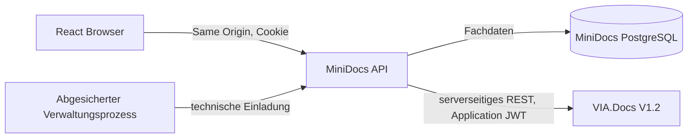

> **Historischer, gesicherter B0-DOC-Ausgangsstand:** Nicht mehr aktiv pflegen. Maßgeblich ist [die konsolidierte Fassung](../ARCHITECTURE.md); der ursprüngliche Inhalt ist nach diesem Hinweis vollständig erhalten.

# Backend-Architektur V1.0

**Planungsstand:** [ADR-001 bis ADR-012](ARCHITECTURE-DECISIONS.md) sind fachlich freigegeben; ADR-013 bis ADR-016 sind offen beziehungsweise vorgeschlagen. Es gibt keine Implementierungsfreigabe und noch kein MiniDocs-Backend. Der historische [Entwurf](../ARCHITECTURE_DRAFT.md) ist keine aktuelle Entscheidungsquelle.

Ein Benutzer besitzt in V1.0 einen privaten Workspace und dieser eine eigene technische VIA.Docs-Identität. Registrierung und Provisionierung sind getrennt; [Identität und Provisionierung](IDENTITY-AND-PROVISIONING.md) beschreibt den Ablauf. Autorisierung, Secret-Schutz und Sicherheitsnachweise stehen in [Sicherheit](SECURITY-ARCHITECTURE.md). Die [Integration](VIA-DOCS-INTEGRATION.md) trennt Quellstand und Deployment; das [logische Modell](DATA-MODEL.md) ist kein Schema.

Das bestehende React-Frontend verwaltet Dokumente, Hierarchie, Tags und seitenweise Transkripte im Arbeitsspeicher. PDF-Import liest Seitenzahl und erzeugt lokale Blob-Quellen; der React-PDF-Viewer rendert fortlaufend und synchronisiert Seiten mit Transkriptkarten. Ein späterer autorisierter Streaming-Zugriff muss dieses Bedienkonzept berücksichtigen; der bestehende Blob-Pfad ist noch kein Backend-Streaming. Suche und Konfliktverhalten müssen vertraglich abgestimmt werden. [Frontend-Architektur](FRONTEND-ARCHITECTURE.md) und [PDF-Entscheidung](M6-C-PDF-ENTSCHEIDUNG.md) bewahren die UI-Abgrenzungen.
