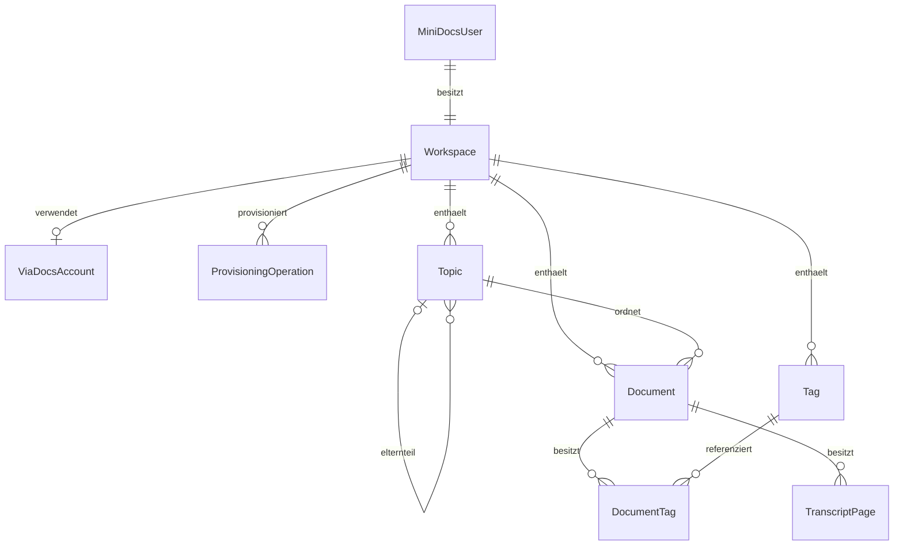

> **Historischer, gesicherter B0-DOC-Ausgangsstand:** Nicht mehr aktiv pflegen. Maßgeblich ist [die konsolidierte Fassung](../ARCHITECTURE.md); der ursprüngliche Inhalt ist nach diesem Hinweis vollständig erhalten.

# Logischer Datenmodellentwurf

**Entwurf, kein freigegebenes physisches Schema.** Tabellen, Datentypen, Indizes, Constraints und Migrationen sind Gegenstand von B0.6. Verbindliche Isolation siehe [ADR-002, ADR-003 und ADR-011](ARCHITECTURE-DECISIONS.md).

Die Darstellung ist logisch und legt keine physischen Schlüssel oder tatsächliche Kardinalität einer Einladung vor ihrer Einlösung fest. `MiniDocsUser`, `UserInvitation`, `Workspace`, `ViaDocsAccount` und `ProvisioningOperation` bilden Benutzer, Einladung, privaten Bereich, technische Identität und kontrollierten Vorgang ab. `Topic`, `Document`, `Tag`, `DocumentTag` und `TranscriptPage` tragen fachliche Daten. Eine MiniDocs-Dokument-ID ist eigenständig und referenziert die VIA.Docs-Datei; gleichnamige PDFs bleiben zulässig. Seitenzahl kann unbekannt sein. `PendingTranscript` ist für den geplanten Transkriptimport zu prüfen; im aktuellen React-Frontend ist kein entsprechendes persistentes Fachmodell bestätigt, der Import ist noch geplant.

Alle fachlichen Beziehungen sind workspace-gebunden; Datenbank-Constraints einschließlich zusammengesetzter Fremdschlüssel verhindern mandantenübergreifende Zuordnung. Themenbäume benötigen Zyklenverhinderung auch bei konkurrierenden Änderungen. Mehrere Tabs benötigen Nebenläufigkeitskontrolle und definierte Konfliktantworten. Upload und Löschung über zwei Systeme benötigen nachvollziehbare Teilfehler- und Wiederanlaufregeln ohne Exactly-once-Versprechen. Papierkorb und endgültige Löschung fachlich abstimmen.

Die bestehende React-Suche nutzt normalisierte Teilstrings, Phrasen, UND über Suchbegriffe und Tags, Datumsfilter, Themenbereich einschließlich Nachfahren, Gewichtung von Titel/Dateiname und Textvorkommen sowie eine Trefferseite. B0.6/B0.7 müssen Semantik und Indexstrategie abstimmen; keine ungeprüften Performancezusagen. Dokumentmetadaten, Themen, Tags und Transkriptseiten sind dauerhaft zu speichern; PDF-Originale bleiben bei VIA.Docs.
